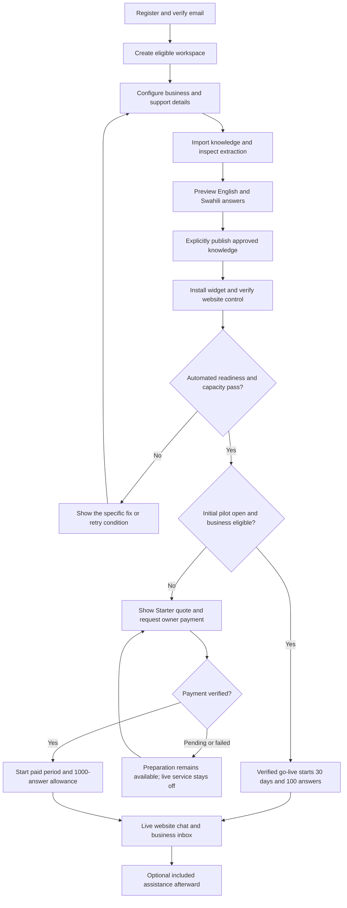
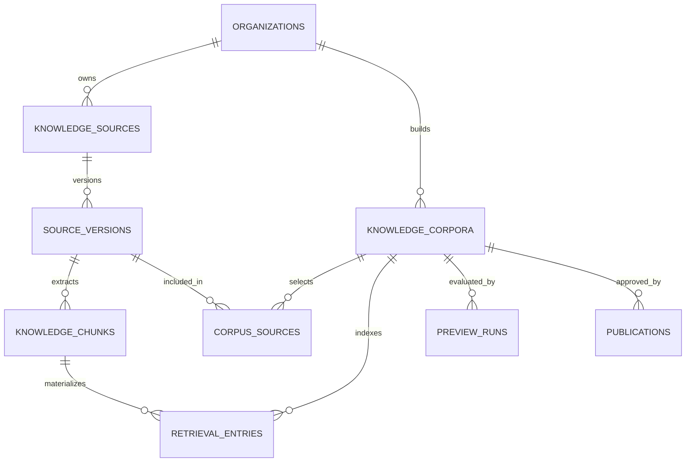
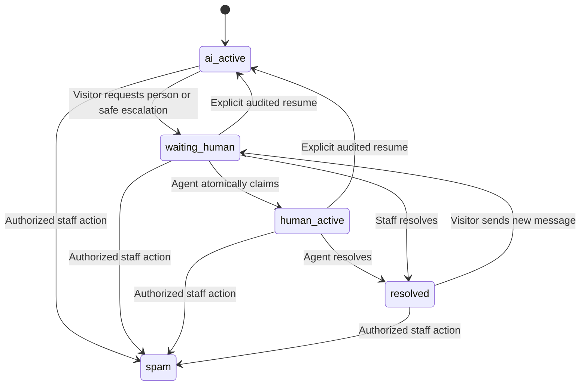
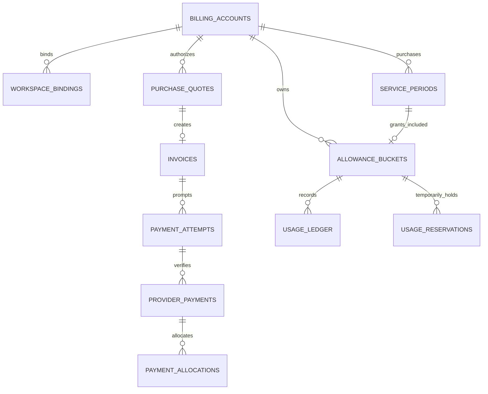
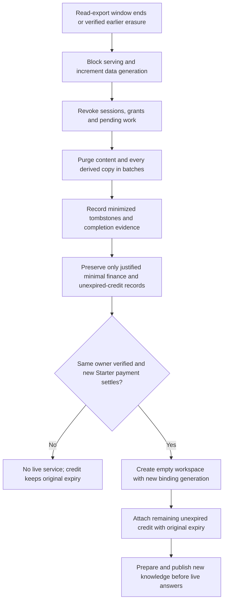

# Sema — Data Model and System Flows

**Version:** 1.0  
**Date:** 16 October 2026 (Africa/Nairobi)  
**Baseline:** [Sema PRD v2.1](sema-production-prd.md)  
**Status:** Implementation design under the founder's engineering delegation; no application, migration or provider account has been created or tested.

**Physical implementation design:** [Technical design v1.0](sema-technical-design.md) maps these 54 logical record types to concrete storage and supplies the schema/API validators. Its physical names and consolidation map govern implementation; the logical records here remain the behavior and provenance reference.

This companion translates the confirmed product into Convex data contracts, user journeys, state transitions and transaction boundaries. The PRD governs product scope and commercial terms. This document supplies engineering defaults; it does not establish provider eligibility, legal compliance, measured answer quality or production readiness.

## Contents

1. [Design decisions](#1-design-decisions)
2. [The end-to-end flow](#2-the-end-to-end-flow)
3. [Shared data conventions](#3-shared-data-conventions)
4. [Workspace and identity model](#4-workspace-and-identity-model)
5. [Knowledge and publication model](#5-knowledge-and-publication-model)
6. [Conversation and handoff model](#6-conversation-and-handoff-model)
7. [Billing and allowance model](#7-billing-and-allowance-model)
8. [Service lifecycle and entitlement rules](#8-service-lifecycle-and-entitlement-rules)
9. [Function and authorization contracts](#9-function-and-authorization-contracts)
10. [Jobs, privacy and recovery](#10-jobs-privacy-and-recovery)
11. [Validation scenarios and traceability](#11-validation-scenarios-and-traceability)
12. [Implementation sequence and remaining evidence](#12-implementation-sequence-and-remaining-evidence)
13. [Verified platform references](#13-verified-platform-references)

## 1. Design decisions

The architecture remains Next.js on Netlify, Convex with the assessed Better Auth integration, Workers AI, IntaSend and Resend. There is no parallel Postgres database, PartyServer service or separate workflow vendor. Component-managed identity/workflow tables are separate from Sema's application-owned tables.

| Decision | Why it matters | Standing |
|---|---|---|
| One organization is one business on one production website | Keeps tenancy, knowledge, seats and usage aligned with Starter | Confirmed product |
| Public self-service preparation and activation | Automated checks enforce eligibility, publication, site control, capacity and payment; assistance is available afterward | Confirmed product |
| Free enrollment is a versioned initial-pilot offer | Registration does not reserve a trial; accepted pilots retain 30 days/100 answers when enrollment closes | Confirmed product; versioning is engineering design |
| Authentication and business permissions are separate | A valid login cannot select an arbitrary workspace or obtain operator access | Engineering design required by the PRD |
| Published knowledge is an immutable corpus snapshot | A draft cannot leak into live chat; publication is a small atomic pointer change | Engineering design |
| Conversation mode has a revision number | A handoff invalidates pending AI candidates before they can commit | Engineering design |
| Service periods, allowance buckets and money records are separate | A top-up cannot renew service; monthly allowances and 90-day packs have different lifetimes | Engineering design supporting confirmed billing |
| Financial identity survives separately from erased workspace content when justified | Preserves lawful minimal payment records and unexpired credit without restoring deleted knowledge or conversations | Confirmed product; identity/retention checks outstanding |
| Queries return explicit role-specific views | Internal notes, payment metadata and source originals never enter visitor subscriptions | Engineering design |
| Durable jobs hold identifiers and checkpoints | Retries and restores reload current permissions and deletion state instead of replaying copied private payloads | Engineering design |

Convex mutations provide atomic database changes; external network work belongs in actions. Sema consequently uses **validate/reserve → external work → revalidate/commit**, with reconciliation for ambiguous external outcomes. This is an application design derived from Convex's function model. [Mutations](https://docs.convex.dev/functions/mutation-functions), [actions](https://docs.convex.dev/functions/actions).

## 2. The end-to-end flow



**Start-time distinction:** `goLiveAt` is the accepted production-widget activation handshake after owner action and automated site verification. It starts an eligible free pilot exactly once. `firstGenuineConversationAt` is a separate analytics milestone; the owner testing the widget must not be reported as customer demand. Imports, previews, registration and assistance appointments do not start a free pilot. A paid period starts at verified payment under the agreed billing rules, so complete readiness before payment wherever possible.

**No founder queue:** Valid self-service actions do not require a booking or operator approval. Ineligible use, failed domain proof and exhausted capacity return specific outcomes. Exceptional eligibility review is distinct from standard onboarding; it must not silently admit an excluded sector.

## 3. Shared data conventions

### 3.1 Types, scope and ownership

The field lists below are logical schema contracts, not runnable `schema.ts`. `Id<table>` denotes an application document reference; `?` means optional; `Enum` means a closed validated set; `Timestamp` is a UTC Unix timestamp in milliseconds. Convex supplies `_id` and `_creationTime`; add `updatedAt` only where mutable state needs it. Reference fields require application existence and same-tenant checks; they are not SQL foreign keys. [Data types](https://docs.convex.dev/database/types).

The catalog separates 54 logical record types for review. This is not a requirement for 54 independently deployed services or bespoke components. They share one Convex backend. During schema implementation, tightly related records can share a validated physical table when indexes, permissions, retention and invariants remain clear; do not introduce a generic untyped entity store merely to reduce the table count.

| Convention | Rule |
|---|---|
| Tenant scope | Every operational child carries `organizationId`; the server derives it from the authorized parent. No client-provided tenant ID is sufficient authority. |
| Financial scope | Financial children carry `billingAccountId`; an active authorized binding identifies the current organization. Historical erased-organization references are opaque identifiers, never routes to deleted content. |
| Auth subject | `authUserId` is an opaque string from the assessed auth component, not a client email and not an application `Id<users>`. Do not duplicate passwords, reset tokens or auth sessions. |
| Money | Safe integer minor units: KES 2,500 = `250000`, KES 500 = `50000`; fixed currency `KES` at launch. Validate integer/range and use explicit rounding for verified fee/tax formulas. |
| Counts | Nonnegative bounded safe integers. No fractional reply units. Ledger deltas are signed integers with validated reason types. |
| Time | Periods and leases use half-open intervals: `startAt <= now < endAt`. Store UTC; display Africa/Nairobi. Pilot, pack, grace and export lifetimes use exact durations; monthly renewals use the Nairobi calendar anchor. |
| Client retries | Each accepted command has an actor-scoped `requestId` or domain-specific key. Reusing a key with a different payload hash returns `IDEMPOTENCY_CONFLICT`. |
| Data minimization | Store content once where feasible. Derived excerpts, search entries, files and exports remain linked to provenance for deletion. No raw text/phone/email in general telemetry. |
| Revisions | `authorizationRevision`, `knowledgeRevision`, `modeRevision` and `dataGeneration` invalidate stale work. They are distinct counters, not interchangeable timestamps. |
| Secrets | Raw visitor/invitation tokens are returned once and stored only as cryptographic digests. Provider secrets, webhook challenge and encryption keys remain in approved secret configuration. |
| Bounds | Paginate lists; cap arrays, jobs and writes. Never put complete transcripts, all workspace messages or every source version in one document. |

Sema uses separate development/preview/production deployments. Cross-environment IDs and provider resources cannot grant entitlement. Record provider environment on payment records and environment on events; never test live payments or real visitor data from routine previews.

### 3.2 Index notation and uniqueness

`by_org_status(organizationId, status, updatedAt)` denotes an ordinary composite index in that order. Queries must use suitable leading equality fields before a range; a post-read filter is not a substitute for a scoped index. Select the smallest indexes required by measured access patterns and paginate growing ranges. [Indexes](https://docs.convex.dev/database/reading-data/indexes/), [pagination](https://docs.convex.dev/database/pagination).

**U** below marks an application-enforced unique key. For each U key, the **same mutation** checks the exact indexed key and inserts or returns the existing record; concurrent mutation tests must prove the invariant. `.unique()` checks a query result; it does not create a database uniqueness constraint. Never implement check-then-insert through separate action calls. Duplicate-corruption detection must alert rather than arbitrarily select a record.

### 3.3 Authoritative records and projections

Authoritative records include accepted offers, publication receipts, conversation messages, verified payment facts, service periods and financial/usage entries. Mutable summaries include available-balance counters, inbox lists, aggregate analytics and job status. Update a summary in the same mutation as its canonical effect where needed, then periodically reconcile it. Browser analytics never determines charges or entitlement.

## 4. Workspace and identity model

### 4.1 Tables and access paths

| Table | Key fields beyond system fields | Essential indexes / constraints |
|---|---|---|
| `staffProfiles` | `authUserId`, `displayName`, `preferredLanguage: en/sw`, `status` | **U** `by_auth(authUserId)`; auth component owns email and credentials |
| `organizations` | `name`, `createdByAuthUserId`, `lifecycleState`, `dataGeneration`, `authorizationRevision`, `knowledgeRevision`, `activeCorpusId?`, `lastOwnerActivityAt`, `contentPurgeAt?` | `by_state_purge(lifecycleState, contentPurgeAt)`; one current corpus pointer; create owner membership atomically |
| `memberships` | `organizationId`, `authUserId`, `role: owner/agent`, `status`, `revision` | **U** `by_org_user(organizationId, authUserId)`; `by_user_status(authUserId, status)`; `by_org_status(organizationId, status)` |
| `invitations` | `organizationId`, `emailDigest`, `tokenDigest`, `role: agent`, `expiresAt`, `status`, `invitedByAuthUserId` | **U** `by_token(tokenDigest)`; `by_org_status(organizationId, status)`; reserve the second seat while invitation is valid |
| `businessSettings` | `organizationId`, safe display/branding fields, `logoAssetId?`, `supportContact`, `privacyUrl`, `timezone`, bounded weekly hours/holiday overrides, `conversationRetentionDays: 30/90`, `revision` | **U** `by_org(organizationId)`; private settings and public widget projection are separate views |
| `widgets` | `organizationId`, `publicKey`, `status`, normalized primary site, `configRevision`, `goLiveAt?`, `firstGenuineConversationAt?` | **U** `by_public_key(publicKey)`; **U** `by_org(organizationId)` |
| `siteVerifications` | `organizationId`, `widgetId`, exact HTTPS origin, registrable-domain identity, `challengeDigest`, `method`, `expiresAt`, `verifiedAt?`, `status` | **U** `by_widget_origin(widgetId, origin)`; `by_status_expiry(status, expiresAt)` |
| `supportGrants` | `organizationId`, `operatorAuthUserId`, allowed operation set, `approvedByAuthUserId`, `reason`, `expiresAt`, `revokedAt?` | `by_org_operator(organizationId, operatorAuthUserId)`; `by_expiry(expiresAt)` |
| `agentPresence` | `organizationId`, `membershipId`, `availability: available/away`, `lastHeartbeatAt`, `leaseExpiresAt`, `revision` | **U** `by_org_member(organizationId, membershipId)`; `by_org_availability(organizationId, availability)` |

`lifecycleState` is a coarse operational projection: `preparing`, `live`, `human_grace`, `read_only`, `purging`, `erased`, or `blocked`. It is not the sole entitlement check; §8 derives permissions from actual deadlines, holds and financial records.

### 4.2 Signup, invitations and site control

1. Better Auth creates and verifies the account. A session-validating backend helper resolves the auth subject. Sema creates `staffProfiles` idempotently.
2. `createWorkspace` atomically creates the organization, owner membership, default settings, widget and financial binding. Public-safe use declaration and accepted notice versions are recorded. Default settings are private until safe public configuration is ready.
3. Verify email before expensive imports/preview. Count active seats plus outstanding unexpired invitation reservations against the two-seat total. Invitation acceptance verifies the intended email through the auth system and atomically creates the membership; no email-only account takeover.
4. Removing/replacing an agent revokes membership and presence, increments authorization state and releases the seat. Owner transfer is a separate verified acceptance operation that atomically demotes the old owner, promotes the new one, updates financial/recovery ownership bindings and respects the two-seat total; it cannot leave the workspace ownerless. The former owner loses owner-only billing/recovery privileges, and an audited transfer record preserves the necessary financial chain of authority.
5. Prove control with a short-lived website challenge, such as an HTTPS verification file or approved page meta token. Apply the URL fetch/SSRF rules to verification too. Require exact allowed origins; apex/www are the same commercial site but still separately authorized origins. Do not treat arbitrary subdomains or sibling domains as equivalent.
6. Before activation, verify published corpus, English/Swahili preview completion, site proof, support contact/hours, notices, eligible sector and resource capacity. Store a readiness digest; recheck dependencies in the activation mutation rather than trusting an old checklist.

Better Auth's session-validating helper and current Sema membership are both required. A decoded identity alone does not validate the session. Integration compatibility, reset revocation and the 60-second access-stop requirement still need proof. [Authorization documentation](https://labs.convex.dev/better-auth/basic-usage/authorization).

**Presence default:** Heartbeat every 30 seconds while the inbox is active; expire availability after 60 seconds without renewal. Live-human availability requires active service, open business hours, active membership, an available agent and an unexpired presence lease. Sema support appointments do not create business-agent presence. Batch expiry processing and avoid high-frequency workspace-wide reactive invalidation.

## 5. Knowledge and publication model

### 5.1 Relationships



### 5.2 Tables and access paths

| Table | Key fields | Essential indexes / constraints |
|---|---|---|
| `knowledgeSources` | `organizationId`, `kind: faq/txt/pdf/docx/webpage`, safe title, `draftVersionId?`, `publishedVersionId?`, `status`, `deletedAt?` | `by_org_status(organizationId, status)`; source identity survives edits, content does not mutate in place |
| `sourceVersions` | `organizationId`, `sourceId`, `versionNumber`, checksum, language, `rawAssetId?`, public URL?, extraction state/warnings, extractor/chunker versions, byte/page/chunk counts, `createdByAuthUserId` | **U** `by_source_version(sourceId, versionNumber)`; `by_org_state(organizationId, extractionState)` |
| `knowledgeChunks` | `organizationId`, `sourceId`, `sourceVersionId`, ordinal, text, page/section, language, content hash, `deletionState` | **U** `by_version_ordinal(sourceVersionId, ordinal)`; `by_org_version(organizationId, sourceVersionId)` |
| `knowledgeCorpora` | `organizationId`, `purpose: candidate/preview/live/retired`, `state: building/ready/failed/retired`, `manifestHash`, embedding model/version/dimension, `baseKnowledgeRevision`, counts, `previewRevision` | `by_org_state(organizationId, state)`; one active pointer and bounded in-progress builds |
| `corpusSources` | `organizationId`, `corpusId`, `sourceId`, `sourceVersionId` | **U** `by_corpus_source(corpusId, sourceId)`; `by_version(sourceVersionId)` |
| `retrievalEntries` | `organizationId`, `corpusId`, `chunkId`, `sourceVersionId`, `retrievalScope`, text, embedding vector, language | **U** `by_corpus_chunk(corpusId, chunkId)`; ordinary `by_scope(retrievalScope)`; vector `by_embedding` and text `by_text`, both filtered by `retrievalScope` |
| `previewRuns` | `organizationId`, `corpusId`, manifest hash, `actorAuthUserId`, language, bounded test case/result references, pipeline version, completion state/time | `by_org_corpus(organizationId, corpusId)`; previews are nonbillable but budgeted |
| `publications` | `organizationId`, `corpusId`, manifest hash, approved source/version set digest, preview-run references, `approvedByAuthUserId`, `publishedAt`, previous corpus ID? | `by_org_time(organizationId, publishedAt)`; immutable approval receipt |

Text and embeddings in `retrievalEntries` are deliberate derived copies for one immutable search corpus. Bound live/candidate/preview copies, reserve capacity before building, and purge all copies through chunk/version provenance. The initial budget is one live corpus and one shared candidate/preview build per workspace; retire old index entries after pointer switch. The PRD's rollback window does not require keeping old search indexes: retained source versions can be reindexed before a new owner preview/publication.

The vector dimension is a deployment/schema choice matched to the evaluated embedding model. Do not hardcode an assumed provider dimension or mix versions. A dimension change needs a side-by-side table/index migration and temporary capacity headroom.

### 5.3 Import and explicit publication flow

1. **Reserve:** `requestImport` validates actor, source type, 2 MB/file, 50-page/extraction boundaries, plan limits and global storage/model headroom. It creates a draft version, quota reservation, asset record and durable job. Manual FAQ edits create new versions through the same approval path.
2. **Transfer safely:** Enforce a byte cap while receiving the file, then verify actual type/size and quarantine it. Do not issue an unrestricted upload path that bypasses the preflight limit. Whether the selected authenticated HTTP upload path enforces all limits is an implementation spike.
3. **Process:** The job scans/extracts in a bounded isolated context, chunks, embeds and persists results in bounded batches. A single public-page fetch revalidates DNS/IP/redirects; it never follows links recursively. Scans, encrypted files and malformed/unsafe inputs fail with specific reasons.
4. **Build:** Create a candidate manifest from the intended complete set of source versions. Unchanged published versions can be reused logically; materialized retrieval entries are built in a separate scope. Reuse compatible embeddings where available; never borrow across tenants.
5. **Preview:** Owner previews the exact candidate in English and Swahili, inspects extraction, warnings and conflict results, and approves public-safe content. Test results bind to corpus manifest and pipeline version. An edit produces a new manifest and invalidates prior approval eligibility; merely saving or finishing a job cannot publish.
6. **Publish:** `publishCorpus` rechecks ownership, preview evidence, complete indexes, source eligibility, current base revision and deletion status. In one mutation, it creates the approval receipt, updates published source pointers, switches `activeCorpusId`, increments `knowledgeRevision` and queues content-free events/cleanup. A competing publication fails with `STALE_CORPUS`; the owner previews the refreshed candidate.
7. **Retire:** Old entries stop being live immediately through the active pointer check. Cleanup reclaims their index/storage footprint without making rollback automatic.

Batch processing may take many mutations; **only the final pointer switch is atomic**. The design does not claim that extracting/indexing an entire PDF is one transaction.

### 5.4 Retrieval and immediate removal

The server derives `retrievalScope = organizationId + corpusId + embeddingVersion` from authorized records. The exact serialized encoding is canonical and collision-safe. Live requests can use only the current published corpus; owner preview may use its explicitly authorized candidate scope. Vector search uses equality on this scope; text retrieval uses the same partition. Convex's documented vector filters support equality/OR rather than an arbitrary SQL predicate. [Vector search](https://docs.convex.dev/search/vector-search), [text search](https://docs.convex.dev/search/text-search).

Load candidates through an internal query that verifies tenant, manifest, current source version, deletion state and permitted request mode **before sending text to Workers AI**. At answer commit, repeat the relevant checks. Do not rely solely on a prefilter or the initial retrieval snapshot.

On unpublish/delete, immediately block the source/version and increment `knowledgeRevision`; new retrieval validation and pending answer commits reject it. Rebuild the remaining corpus asynchronously. During that rebuild, stale candidates may be filtered out and Sema may abstain rather than give a weak answer. Privacy erasure additionally redacts affected historical answers and copies; ordinary removal follows the PRD's separate historical-conversation policy. Already disclosed information cannot be recalled from a visitor's device.

## 6. Conversation and handoff model

### 6.1 Tables and access paths

| Table | Key fields | Essential indexes / constraints |
|---|---|---|
| `visitorSessions` | `organizationId`, `widgetId`, `conversationId`, `tokenDigest`, origin, `expiresAt`, `revokedAt?`, notice version, preferred language | **U** `by_token(tokenDigest)`; `by_conversation(conversationId)`; `by_expiry(expiresAt)` |
| `conversations` | `organizationId`, `widgetId`, `mode: ai_active/waiting_human/human_active/resolved/spam`, `modeRevision`, `contentRevision`, `assignedMembershipId?`, `lastSequence`, `visitorTurnCount`, `lastActivityAt`, `expiresAt`, outcome | `by_org_mode_activity(organizationId, mode, lastActivityAt)`; `by_org_assignee(organizationId, assignedMembershipId, lastActivityAt)`; `by_expiry(expiresAt)` |
| `conversationContacts` | `organizationId`, `conversationId`, optional name/email/normalized phone, purpose, permission/notice version and time | **U** `by_conversation(conversationId)`; never infer verified identity from these values |
| `messages` | `organizationId`, `conversationId`, `sequence`, author kind/ID, language, safe body, `clientCommandId?`, `replyToTurnId?`, `answerRunId?`, type, redaction state | **U** `by_conversation_sequence(conversationId, sequence)`; `by_conversation_command(conversationId, clientCommandId)`; `by_turn_reply(replyToTurnId)` with typed effect checks |
| `conversationTurns` | `organizationId`, `conversationId`, `clientTurnId`, payload hash, visitor message ID, outcome, result message ID?, `modeRevisionAtAccept`, `dataGeneration`, reservation/run IDs? | **U** `by_conversation_client(conversationId, clientTurnId)`; `by_org_outcome(organizationId, outcome)` |
| `answerRuns` | `organizationId`, `turnId`, `attemptNumber`, processing state, corpus/model/prompt/embedding versions, source references, decision reason, latency/tokens/cost references, validation result | **U** `by_turn_attempt(turnId, attemptNumber)`; `by_org(organizationId)` uses the automatic creation-time tie-break for chronological reads |
| `messageEvidence` | `organizationId`, `messageId`, `sourceVersionId`, `chunkId`, approved excerpt/reference, corpus ID | `by_message(messageId)`; `by_version(sourceVersionId)`; parent deletion removes copies |
| `conversationNotes` | `organizationId`, `conversationId`, `authorMembershipId`, text, edit revision | `by_conversation(conversationId)`; staff-only table |
| `conversationEvents` | `organizationId`, `conversationId`, event type, actor, reason, mode revision, time | `by_conversation(conversationId)`; content-free handoff/claim/resume/resolution history |
| `feedback` | `organizationId`, `conversationId`, `messageId?`, rating/outcome, optional bounded comment | `by_conversation(conversationId)`; comments follow conversation retention |
| `knowledgeGaps` | `organizationId`, `conversationId`, `turnId`, reason/topic, status, proposed FAQ source ID? | `by_org_status(organizationId, status)`; `by_conversation(conversationId)`; link to message instead of duplicating its text |

Each table is bounded per document. Citations are separate records so source erasure can find generated copies without scanning every conversation. No visitor attachments, synchronized email/WhatsApp replies or autonomous tools are introduced.

### 6.2 Accepted visitor message to answer

```mermaid
sequenceDiagram
    participant V as Visitor widget
    participant M as Convex mutation
    participant A as AI action
    participant P as Workers AI
    participant S as Authorized subscription
    V->>M: sendTurn(token, clientTurnId, text)
    M->>M: Check token, tenant, service, mode, limits and duplicate key
    M->>M: Commit visitor message, turn and eligible reservation
    M-->>V: Accepted turn ID and pending or human state
    M->>A: Schedule bounded processing after commit
    A->>M: Load authorized context and active corpus snapshot
    A->>P: Minimal approved context and bounded question
    P-->>A: Candidate answer
    A->>A: Validate support, citations and language
    A->>M: finalizeAnswer(runId, candidate)
    M->>M: Recheck source, mode, lease, period, token acceptance and deletion
    M->>M: Commit answer, one usage debit and event; or discard and release
    M-->>S: Committed visitor-visible state changes
    S-->>V: Answer, fallback or handoff status
```

`sendTurn` persists the accepted visitor message before background generation. For a new turn, it allocates the next sequence number and increments activity/retention in the same mutation. Repeating the same key/text returns the existing outcome. Different text with the same key is a conflict, not another message.

Detect explicit human requests before reserving model allowance. If mode is human/waiting, enqueue only the human-visible visitor message. If AI is permitted but quota is unavailable, persist the message, show the nonbillable quota notice and offer handoff; quota exhaustion does not itself pretend an agent has claimed the thread. Active human chat continues when AI allowance is exhausted.

For ordinary AI turns, reserve one reply unit and bounded internal processing capacity. Release the reply reservation for greetings, clarification, fallback, errors, invalid answers and discarded candidates. Internal provider costs are recorded even when no customer unit is consumed. Exact fallback rules and quality thresholds remain those in PRD §7.

**Ordering default:** At most one generation runs per conversation. Additional accepted visitor turns enter a bounded ordered queue within the workspace concurrency limit. A short burst can be handled in order, but no answer can silently cover several metered turns. If the processing queue cannot start within 10 seconds, give a clear nonbillable retry/handoff outcome; no invisible indefinite queue. After 30 accepted visitor turns, offer a new thread or handoff according to the PRD limit.

Only validated committed responses reach the visitor. The initial design does not stream unvalidated model tokens. A spinner/pending state is safe; showing a draft answer and retracting it after validation is not equivalent to preventing disclosure.

### 6.3 Handoff, claims and resumption



- `requestHandoff` atomically changes mode, increments `modeRevision`, records the reason and creates one notification job per handoff transition. A retried request does not send another alert.
- `claimConversation` checks current mode/revision and active membership. Two simultaneous claims produce one winner; the loser gets current assignment, not a second owner of the conversation.
- `sendHumanReply` checks service permission and assignment. An unassigned owner/agent must claim atomically before replying; a reassignment is an explicit audited operation. Human reply and AI finalization serialize on the conversation document.
- `finalizeAnswer` requires the same `modeRevision` that authorized generation and current `ai_active`. A later handoff, resolution, spam action or claim invalidates that run; discard it and release its reservation.
- `resolveConversation` records who resolved and the outcome source. Silence/timeout is `unconfirmed_closure`, never a verified resolution.
- New messages after resolution reopen to `waiting_human`. “Resume AI” is an explicit authorized command, rechecking live AI permission and knowledge readiness; no automatic bot reentry.

If a token expires during generation, discard the candidate and release its customer-unit reservation; an expired session cannot retrieve a new billable reply. A revoked/deleted session or conversation also invalidates pending work immediately. If the visitor merely closes the widget while its session remains valid, a committed answer remains retrievable under that token; persistence still does not prove reading. A saved human reply does not prove delivery or reading. After the visitor leaves/expires, the business can manually follow up using optional contact details through its existing approved channel.

### 6.4 Realtime views and expiry

`watchVisitorConversation` returns only that session's visible messages, safe source labels and handoff state. `watchInbox` returns bounded staff summaries; notes and contacts require separate authorized reads. Never return full database documents by default.

Use ordered persisted message sequence numbers for reconnect and deduplication; reactive delivery is not an external exactly-once messaging guarantee. Fetch missing authorized messages after a known sequence. Redaction/deletion also needs updates to existing messages: subscribe to the active bounded window and a conversation content revision; invalidate/refetch affected history rather than relying only on append-only sequence cursors.

Subscriptions track database dependencies. Time passing alone must not be assumed to revoke a cached subscription. Each query reads the relevant session, membership, service/hold and deletion records; mutation paths check deadlines directly. Schedule deadline state changes and use a bounded expiry sweep, with proof of the 60-second access-stop ceiling. Client timers clear expired UI as additional protection, never as the authorization boundary. [Realtime](https://docs.convex.dev/realtime), [scheduled functions](https://docs.convex.dev/scheduling/scheduled-functions).

## 7. Billing and allowance model

### 7.1 Financial relationships



The diagram shows logical associations, not foreign-key enforcement or cross-provider atomicity. An unexpected payment may remain unallocated rather than being forced into a service period.

### 7.2 Tables and access paths

| Table | Key fields | Essential indexes / constraints |
|---|---|---|
| `billingAccounts` | stable business identity key/digest, verified owner subject/binding, account status, current organization ID?, lawful financial-retention deadline?, credit-retention deadline? | **U** `by_business_key(businessIdentityKey)` where verified; `by_owner(verifiedOwnerAuthUserId)`; no name-only uniqueness |
| `workspaceBindings` | `billingAccountId`, `organizationId`, `generation`, verified owner subject, `boundAt`, `unboundAt?` | **U** `by_org(organizationId)`; `by_account_generation(billingAccountId, generation)`; at most one active binding/account |
| `offerVersions` | immutable offer/version key, `kind: pilot/starter/topup`, base minor amount, currency, units, duration rules, seat/resource limits and terms version | **U** `by_key(offerKey)`; separate public pilot-enrollment control references its current version |
| `pilotEnrollments` | `billingAccountId`, `organizationId`, `offerVersionId`, acceptance/readiness digest, `goLiveAt`, `endAt`, `status`, early-conversion reference? | **U** `by_account(billingAccountId)`; `by_end(endAt)`; eligibility also uses verified business/domain/fraud signals |
| `purchaseQuotes` | `billingAccountId`, `organizationId`, request/payload keys, offer version, base/tax/fee/total minor amounts, calculation/terms versions, quoted period rule or pack lifetime, `expiresAt`, owner authorization | **U** `by_account_request(billingAccountId, requestId)`; `by_expiry(expiresAt)`; totals immutable after authorization |
| `invoices` | account/quote IDs, immutable invoice number, currency/gross due, purpose, service-period allocation rule, status, verified paid amount | **U** `by_quote(quoteId)`; **U** `by_number(invoiceNumber)`; `by_account_status(billingAccountId, status)` |
| `paymentAttempts` | account/invoice IDs, initiation key, provider/environment, provider resource ID?, status, `nextCheckAt`, initiation lease/deadlines, authorized payer reference minimized | **U** `by_invoice_key(invoiceId, initiationKey)`; `by_provider_resource(provider, environment, providerResourceId)`; `by_status_next(status, nextCheckAt)` |
| `providerPayments` | `billingAccountId?`, attempt/invoice references when matched, provider/environment/resource ID, verified status and time, provider paid-at time?, currency, gross amount, reference, minimal verification evidence | **U** `by_resource(provider, environment, resourceId)`; `by_account(billingAccountId)`; unmatched facts remain operator-only until matched |
| `paymentAllocations` | provider payment ID, invoice ID, account ID, allocated minor amount, effect key, service period/bucket ID? | **U** `by_effect(effectKey)`; `by_payment(providerPaymentId)`; enforce one automatic full allocation/payment and invoice settlement |
| `servicePeriods` | account/organization IDs, plan version, billing anchor, start/end, verified allocation ID, included units `1000`, `status`, `cancelAtPeriodEnd` | **U** `by_allocation(paymentAllocationId)`; `by_account_start(billingAccountId, startAt)`; reject overlapping effective periods |
| `allowanceBuckets` | account ID, organization binding/generation, `kind: pilot/included/topup/correction`, `spendClass: pilot/included/topup`, origin reference, `unitsGranted`, signed `unitsAdjusted`, `unitsUsed`, `unitsReserved`, start/end, status | **U** `by_origin(originKey)`; `by_account_class_end(billingAccountId, spendClass, endAt)`; `by_end(endAt)` |
| `usageReservations` | account/organization/turn IDs, bucket ID, service/pilot period reference, units `1`, mode/knowledge/data revisions, `expiresAt`, status | **U** `by_turn(turnId)` for one live reservation state; `by_status_expiry(status, expiresAt)` |
| `usageLedger` | account ID, organization generation, bucket ID, effect key, turn/message IDs? with content-free historical references, signed units, reason, reversal reference?, time | **U** `by_effect(effectKey)`; `by_bucket(bucketId)`; `by_account_time(billingAccountId, occurredAt)` |
| `financialAdjustments` | account/payment/allocation IDs, `kind: refund/reversal/unallocated_credit`, amount, reason, approval actor, provider operation/status/reference | **U** `by_operation(operationKey)`; `by_account_status(billingAccountId, status)`; no silent edit to payment history |

The catalog separates money, service and reply units. A payment receipt is not a tax-invoice compliance claim; tax/fee permission, rates, invoice numbering/required fields and provider refund execution still need the PRD's Finance/Legal checks. Do not implement an invented tax rate or silently absorb/add a fee contrary to the confirmed pricing policy.

### 7.3 Offer constants and eligibility

| Offer | Base price | Service / units | Expiry and constraints |
|---|---|---|---|
| Initial pilot | Free | 30 days, 100 total substantive answers, two staff seats | Enrollment open only during initial pilot phase; clock starts at verified go-live; no top-ups |
| Starter | KES 2,500 plus applicable disclosed tax/processing fees | One service month, 1,000 included substantive answers, two seats, one website | Owner-authorized M-Pesa renewal; no automatic debit; included answers do not roll over |
| Top-up | KES 500 plus applicable disclosed tax/processing fees | 100 additional substantive answers | 90 × 24 hours from verified purchase; usable only during active paid service; no subscription extension |

`pilotEnrollmentOpen` is an operator-controlled, audited global setting with revision and offer version, separate from global capacity and emergency kill switches. `activatePilot` reads that control and the per-business eligibility record in its transaction. Closure racing activation has one serial outcome: a successfully committed enrollment keeps its original terms; a later activation receives the current paid offer. Do not silently substitute a paid purchase for an earlier free confirmation.

`checkoutStage` is separately `disabled`, `controlled_pilot_conversions` or `broad_paid`. G4 prerequisites permit existing eligible pilot businesses to buy Starter during controlled conversion; G5 permits broad paid activation after the two distinct verified conversions and all remaining evidence. A new business registering between free enrollment closure and broad paid availability can prepare/preview, with the global release status clearly displayed. This is a release-stage constraint, not an individual founder approval queue.

Business identity is a reviewed combination of verified ownership, site/domain identity and abuse signals; there is no foolproof automatic duplicate-business detector. Do not demand national IDs as a new MVP requirement. Ambiguous reuse receives a specific eligibility/recovery path. A recreated organization, changed email or reinstalled widget must not automatically mint another pilot.

### 7.4 Payment flow and ambiguous outcomes

```mermaid
sequenceDiagram
    participant O as Owner
    participant M as Convex mutation
    participant A as Payment action
    participant I as IntaSend
    O->>M: Authorize itemized quote and request STK
    M->>M: Lock invoice and one initiation attempt
    M->>A: Schedule initiation
    A->>I: Initiate owner-authorized M-Pesa prompt
    I-->>A: Provider resource or ambiguous timeout
    A->>M: Persist known result; keep uncertain attempt pending
    I->>A: Webhook callback
    A->>M: Persist validated callback for processing
    A->>I: Query authoritative payment status
    I-->>A: Status, resource, reference, currency and amount
    A->>M: Apply verified payment fact
    M->>M: Allocate once; create period or top-up; update service projection
    M-->>O: Verified receipt and actual entitlement
```

The callback path uses the current documented IntaSend challenge contract, request validation and authoritative status lookup; it does not invent a signature header. Require `COMPLETE` and exact invoice/reference, currency, gross amount, merchant/environment and resource matching before entitlement. Follow the provider contract during implementation. [M-Pesa STK](https://developers.intasend.com/guides/collections/mpesa-stk-push/), [webhooks](https://developers.intasend.com/guides/webhooks/).

Payment initiation has a leased `initiating` state. If the external call times out or the worker dies after sending it, move to `unknown`, reconcile first, and prevent another blind prompt. Provider idempotency is used only if the selected API actually supports it. Two genuine payments for one invoice produce one automatic allocation and a reviewed duplicate refund/credit; they do not silently buy two months.

Recheck pending status after 1, 5, 15 and 60 minutes and at 24 hours within provider limits, plus daily reconciliation. A browser redirect, screenshot, webhook body alone or net settlement amount cannot activate service. Verified reversals/refunds create adjustments and an alert; an older pending callback cannot downgrade an already verified payment.

For an unexpectedly late successful top-up after subscription expiry, preserve the verified purchased credit with its original purchase-verification-based expiry, but leave AI disabled until paid service is active. Do not double-charge or lose the money merely because an asynchronous callback crossed a service boundary. A delayed payment can be recorded even if checkout was subsequently disabled; allocation/refund follows its accepted quote and reviewed financial rules, never silently disappears.

### 7.5 Atomic allowance algorithm

1. Validate a new live turn and current entitlement. Preview uses a separate internal budget and never this ledger.
2. In the acceptance mutation, select a valid bucket: pilot only during pilot; active paid included units first; then unexpired top-ups by earliest end time with a stable ID tie-break. Approved correction buckets inherit their explicitly reviewed spend class. Compute `available = unitsGranted + unitsAdjusted - unitsUsed - unitsReserved`. Reserve one unit and a 60-second lease, bounded additionally by service/pilot and selected bucket expiry. Record the period/binding and revisions.
3. Enforce per-conversation serialization, three AI generations/workspace, the tested global capacity and processing budgets before scheduling. If no slot can be admitted within the bounded queue, release capacity and return the safe retry/handoff outcome.
4. After generation/validation, `finalizeAnswer` checks the still-live lease, same eligible period/binding, current conversation revision, corpus/source eligibility, an unexpired and unrevoked visitor session, kill switches and deletion state.
5. On a completed substantive grounded answer, atomically persist the message and evidence references, mark the turn terminal, increment bucket `used`, decrement `reserved`, append one `consume: -1` ledger entry and enqueue events. The **one mutation** is the billable boundary.
6. If another reservation has been released, included units may now be available. Within the same finalization mutation, reselect the highest-priority eligible bucket while treating this operation's own held unit as available to itself; release the old hold and consume from the selected bucket. Never consume a top-up while an unreserved included unit is available. Do not move a run into a different service period or rescue an expired lease; return a safe nonbillable outcome instead.
7. Nonbillable outcome, takeover, deletion, timeout or stale source releases the hold exactly once and marks the turn with a terminal safe outcome. A takeover preserves the human state without inserting a later bot message. A bounded sweeper releases expired holds and settles stranded pending turns; a late action cannot commit after release. Resource/AI costs remain recorded independently.

Ledger grants are positive, consumption negative, and corrections explicit reversing entries. Expiry is an eligibility boundary, not a deletion of history or a surprise new debit. `remaining = sum(signed ledger deltas)` and `available = remaining - reserved`; reconcile counters against those entries. `unitsUsed` counts gross consumed units, while reversals affect `unitsAdjusted`, so a restored unit is not counted twice. Refund/reversal adjustments cannot create a negative spendable balance; handle already-spent entitlements through an audited hold/review. The bucket and global resource-reservation checks occur in the same relevant transaction as the admitted work.

**Corrections:** A verified wrong count reverses the referenced unit effect once. If its original bucket is still valid, restore its usable unit. If the bucket has expired or the account is inactive, record a pending correction entitlement for founder review rather than silently discarding it or inventing an automatic new lifetime. Any replacement bucket has explicit approved units/expiry and audit evidence. Money refunds and reply-unit corrections remain separate operations.

## 8. Service lifecycle and entitlement rules

### 8.1 Time boundaries and access matrix

Use server-authoritative time and interval checks on each operation. Scheduled transitions update UI/projections, but a delayed job must never extend permission.

| State / condition | Prepare / preview / publish | AI answers | Live human chat / new visitor messages | Staff history and export | Billing |
|---|---|---|---|---|---|
| Never activated; eligible preparation | Owner yes, within quotas | Preview only, nonbillable | Off | Own preparation data | Quote/pay when enabled |
| Initial pilot, time valid, units remain | Yes | Yes, ≤100 total | Yes | Yes | Explicit Starter conversion; no top-up |
| Initial pilot, 100 units exhausted, time valid | Yes | Off | Yes until pilot end | Yes | Explicit Starter conversion |
| Paid period active, usable units remain | Yes | Yes | Yes | Yes | Manual renewal/top-up/cancellation |
| Paid period active, all units exhausted | Yes | Off | Yes | Yes | Optional explicit top-up |
| Paid expiry to expiry + 3 days | Engineering default: freeze knowledge/config writes; allow required billing/privacy operations | Off, including top-ups | Yes | Yes | Renew; no new top-up checkout |
| Pilot expiry or paid grace ended; read/export window valid | Off | Off | Off; static business contact only | Read-only inbox/export for 30 days | Purchase/reactivate |
| Content purge in progress | Off | Off | Off | No content access after purge begins | Financial records/credit recovery only |
| Content erased | Empty preparation after verified reactivation | Off until paid + ready | Off until paid + ready | Erased content unavailable | Minimal lawful financial history/unexpired credit only |
| Emergency/security hold | Per verified scope | Block affected work | Preserve safe routes only | Only if safe and authorized | Accept existing financial facts; new checkout depends on hold scope |

The grace write freeze is a delegated conservative default; it preserves the confirmed three days of human chat and does not remove billing/privacy controls. Deletion/export requests may require verified authority and have their own processing state. During read-only access, changing retention or requesting erasure is a privacy operation, not an ordinary content edit.

At activation, derive explicit deadlines:

- Pilot: `endAt = goLiveAt + 30 days`; `readOnlyEndAt = endAt + 30 days`; no human grace.
- Paid expiry without a funded next period: `humanGraceEndAt = periodEndAt + 3 days`; `readOnlyEndAt = humanGraceEndAt + 30 days`.
- Conversation expiry is the earlier of its chosen last-activity retention deadline and workspace purge. Financial records follow their separately approved schedule.
- Cancellation maintains paid service to period end, then follows the confirmed expiry/grace/read-export policy; stop renewal reminders/intents. It does not instantly erase data.

### 8.2 Monthly renewals and early conversion

Starter periods follow the original day-of-month anchor in Africa/Nairobi, clamping individual boundaries when necessary: 31 January → 28/29 February → 31 March. Calendar math must be centralized and tested; a month is not always 30 days.

- **Early pilot conversion:** Explicit verified purchase ends the free pilot, closes its remaining quota and starts a fresh paid service month/1,000-unit bucket. No free-unit rollover or implied charge.
- **Early paid renewal:** Allocate the payment to the next service period. Do not reset current usage or grant spendable next-period units early.
- **Renewal verified within three-day grace:** Retain the original anniversary; the new funded period begins at the prior end, and AI resumes only when the payment is verified. No retroactive AI delivery.
- **Later renewal:** Begin a fresh service period at verification with a new calendar anchor. Unexpired top-ups survive with their original expiry.
- **Top-up purchase:** Grant 100 units with 90-day expiry from verified purchase; do not create a service period. Require active paid service when offering checkout; handle delayed outcomes as §7.4 describes.

Quotes lock money and the accepted period-allocation rule. When exact verification time is unknown, show the rule and expected dates before authorization, then actual dates on the receipt. Do not silently change an authorized quote to a different offer. Test delayed completion across grace/month boundaries and expired quotes; previously initiated successful payments still require reconciliation.

### 8.3 Reusable permission calculation

Implement one server-side policy module used by mutations, queries, HTTP routes and jobs. Conceptual output:

```text
serviceAccess = {
  canPrepare, canPreview, canPublish,
  canReadHistory, canExport,
  canAcceptVisitorMessage, canHumanReply,
  canAttemptLiveAI, canBuyTopup,
  reasonCode, effectiveUntil, policyRevision
}
```

`canAttemptLiveAI` combines funded/pilot time, current units, readiness, conversation mode, knowledge eligibility, abuse/resource limits and kill switches. It cannot be copied from a client plan name. Role checks and visitor scope still apply on top of workspace service permission. Return safe reason codes such as `PAYMENT_REQUIRED`, `PILOT_ENDED`, `AI_ALLOWANCE_EXHAUSTED`, `HUMAN_GRACE`, `READ_ONLY`, `CAPACITY_TEMPORARY`, `SOURCE_NOT_READY`, or `SECURITY_HOLD`; show clear owner/visitor copy in English and Swahili.

## 9. Function and authorization contracts

### 9.1 Public surface

Function names are proposed modules/contracts, not deployed endpoints. Every exported function validates arguments, authorization and permitted return fields. `M` is mutation, `Q` query/subscription, `A` external-work action or HTTP action.

| Operation | Caller / authorization | Main effect or safe response |
|---|---|---|
| `workspaces.create` M | Verified staff session, abuse checks | Create tenant and owner binding once per request |
| `members.invite/accept/remove/transferOwner` M | Owner / intended verified recipient | Atomic seat/ownership enforcement, audit and revocation |
| `settings.update` M | Current owner | Versioned safe configuration; domain/hours changes affect readiness/presence |
| `knowledge.requestImport/editFaq` M + bounded upload A | Owner or explicitly scoped support grant | Reserved draft/job; no publication |
| `knowledge.preview` M → A | Current owner; preview budget | Candidate-only nonbillable evaluation |
| `knowledge.publish/unpublish/delete` M | Owner; preview for publish; reauthentication for destructive scope where required | Revision changes and auditable publication/removal |
| `activation.check` Q / `activation.confirm` M | Owner + current site/readiness evidence | Pilot enrollment or payment-required outcome; no founder gate |
| `widget.bootstrap` A/M | Public widget key + allowed origin, proof/abuse checks | Safe public config and own scoped session only if live messages are enabled |
| `visitor.sendTurn/requestHandoff/contact/feedback` M | Valid session token, bound conversation/origin and operation scope | Persist once; no staff privileges; contact optional |
| `visitor.watchConversation/citation` Q/A | Valid session; current parent/source permissions | Own visible thread or approved excerpt; no raw source files |
| `inbox.list/watchConversation` Q | Current owner/agent session and membership | Paginated staff view; no cross-tenant data |
| `inbox.claim/reassign/reply/resolve/resume` M | Authorized current staff; assignment/revision checks | Serialized conversation transition/message |
| `presence.heartbeat/setAway` M | Current staff, valid service/inbox session | Bounded presence lease; no 24/7 inference |
| `billing.quote/authorize/requestPayment` M → A | Reauthenticated owner, commercial gate enabled | Locked itemized quote and one payment attempt |
| `billing.history/usage` Q | Current owner; scoped lawful recovery route for erased workspace | Canonical periods, receipts and usage; no provider secrets |
| `payments.webhook` HTTP A | Provider challenge/payload checks; no staff session | Durable event capture; verification before entitlement |
| `privacy.export/delete/retention` M → jobs | Reauthenticated owner or verified rights workflow | Scoped durable request with deadlines |
| `files.original/export` HTTP A | Current staff permission, parent relation, file policy/expiry | Authorized bytes; never direct bearer original URL |

Anonymous visitors do not acquire a staff auth subject. Their token check is a separate server helper, applied consistently to reads and writes. Do not put raw session tokens in URLs, analytics, error reports or general logs. Protect staff browser flows against CSRF/origin misuse through the selected integration; CORS is not tenant authorization.

Platform operator authority comes from a separately controlled production identity/role configuration with MFA, never a workspace `owner` role or self-created profile field. Operator settings, emergency holds, refund approvals and privacy workflows each require their specific scope and audit. A support grant permits only its listed workspace operations and expires independently; it cannot promote its holder to operator or owner.

### 9.2 Internal surface

Internal functions include `buildCorpusBatch`, `finalizeCorpusBuild`, `runAnswer`, `finalizeAnswer`, `releaseReservation`, `initiatePayment`, `verifyProviderPayment`, `allocatePayment`, `deliverNotification`, `applyDeadline`, `purgeBatch`, `reconcileLedger` and `rebuildAfterRestore`.

Internal visibility is defense in depth, not permission to trust stale arguments. Each job carries a scoped ID, data generation and idempotency key, then reloads current parents/permissions. Never expose an unrestricted internal function through a generic public dispatcher.

## 10. Jobs, privacy and recovery

### 10.1 Supporting tables

| Table | Key fields | Essential indexes / constraints |
|---|---|---|
| `platformControls` | keyed control kind, policy/version, initial-pilot open flag, checkout stage, kill-switch scope/reason, audited actor | **U** `by_key(controlKey)`; no per-message global counter bundled into this record |
| `resourceBudgets` | scoped resource/window key, limit, committed/reserved usage, reset time, priority/headroom class | **U** `by_scope_window(resource, scopeKey, windowStartAt)`; enforce reservations transactionally |
| `resourceReservations` | resource-budget references, operation key, reserved units/bytes, actual units?, `expiresAt`, status | **U** `by_operation(operationKey)`; `by_status_expiry(status, expiresAt)` |
| `assets` | organization/parent IDs, storage ID?, kind `raw/logo/export`, scan/state, byte count, digest, expires/deleted timestamps | `by_org_kind(organizationId, kind)`; `by_parent(parentType, parentId)`; `by_expiry(expiresAt)` |
| `jobs` | kind, organization/account scope, object ID, content `dataGeneration?`, effect key, state, checkpoint/cursor, attempts, lease, `nextRunAt`, last safe error code | **U** `by_effect(effectKey)`; `by_state_next(state, nextRunAt)`; `by_org(organizationId)` |
| `webhookEvents` | provider/environment/resource ID, event key or payload digest, safe status metadata, received time, verification/process state | **U** `by_event(provider, environment, eventKey)`; `by_state_time(state, receivedAt)`; callback dedup is additional to payment-effect dedup |
| `auditEvents` | scoped actor/type, operation/object ID, reason, grant ID?, safe before/after metadata, time, retention deadline | `by_org_time(organizationId, occurredAt)`; `by_retention(retainUntil)`; no secrets/content snapshots |
| `privacyRequests` | organization/account scope, request type, verified authority reference, status, deadline, progress, minimal exception basis | `by_org_status(organizationId, status)`; `by_status_deadline(status, dueAt)` |
| `deletionTombstones` | scoped entity type/ID or privacy-safe digest, generation/revocation marker, reason, created/retain-until times | **U** `by_entity(entityType, entityKey)`; `by_retention(retainUntil)` |
| `analyticsEvents` | tenant-scoped stable event ID, schema version, event kind, object reference, safe dimensions, time | **U** `by_event(eventId)`; `by_org_time(organizationId, occurredAt)`; short retention, no raw content |
| `metricRollups` | organization/time bucket, metric version, numerator/denominator/counts, last update | **U** `by_org_bucket(organizationId, bucketStartAt, metricVersion)`; derived and rebuildable |
| `evaluationRuns` | dataset/version, pipeline versions, language/category counts, reviewer references, aggregate results, restricted artifact reference | `by_pipeline(pipelineVersion)`; release evidence separate from live preview success |

Model/provider cost facts use minimized job/answer-run records and resource accounting, separately from customer units. Retain measured token/usage inputs and pricing-version references so recurring economics can be recalculated without retaining message text.

### 10.2 Job behavior and capacity

| Job | Retry / idempotency rule | Deadline / failure behavior |
|---|---|---|
| Ingestion / corpus build | Version+stage+batch key; checksum and current generation | Bounded extraction; preserve previous publication; show safe failure and cleanup |
| AI generation | One turn/run lease, at most one approved bounded retry | 15-second generation timeout; fallback/handoff by 20 seconds; no late commit |
| Payment initiation | One leased attempt; resolve ambiguous result before retry | Do not create repeated STK prompts |
| Payment verification/reconciliation | Provider resource + verified fact/effect keys | Retry safe status reads; alert mismatch; no speculative entitlement |
| Email notification | Business event + recipient-purpose key | Durable request precedes send; retry safe operations within actual provider semantics; duplicate email remains possible after ambiguous send |
| Expiry / presence sweep | Entity deadline + revision | Direct deadline checks protect writes; prove subscription invalidation within 60 seconds |
| Purge / export | Request + entity/cursor key | Reload deletion state, bounded batches, audit progress; no resurrection |
| Metrics | Stable event IDs and versioned rollup | Rebuildable; cannot alter billing |

Schedule from mutations when scheduling must commit with the business change. A persisted job remains the recoverable record even when the scheduler already has an invocation. Convex documents atomic scheduling from mutations; external actions still need explicit error/retry handling. [Scheduled functions](https://docs.convex.dev/scheduling/scheduled-functions).

Content jobs reject stale data generations. Financial jobs instead resolve the retained billing account and accepted purchase contract: recording a genuine payment/refund fact must not fail merely because the old operational workspace was erased. That fact grants no access to erased content and cannot create a new workspace without the verified reactivation flow.

Reserve headroom for auth, billing, deletion, safety controls and recovery. The public per-workspace preview allowance is a maximum, not a reserved entitlement to an unlimited aggregate free AI budget. Global breakers run before expensive work and surface truthful retry/reset messages. Meter estimated resources before admission and actual usage afterward; uncertain provider billing is an evidence gap, not permission for unlimited calls. Do not enable paid provider fallback or automatic recharge.

A small pilot can serialize global resource reservations for correctness; measure contention before introducing sharded counters or components. Keep service-control revisions separate from high-frequency counters to avoid invalidating every subscription on every message. Capacity and job polling must fit actual shared Free limits. [Convex limits](https://docs.convex.dev/production/state/limits).

### 10.3 Retention and authorized files

- Conversation content, contacts, notes, feedback comments, gaps and linked excerpts expire after 90 days from last conversation activity, or 30 if selected. Redaction and workspace purge can shorten this. Internal job activity, analytics reads and spam must not indefinitely refresh retention; use accepted conversation activity under the approved policy.
- Never-activated prepared content expires after 30 days without authenticated owner activity, with attempted 7-day/1-day warnings and visible dates, as delegated in the PRD. Preview traffic alone cannot keep it forever.
- Source removal immediately blocks serving; physical serving-store purge target is 24 hours. Superseded versions may be kept up to 30 days for owner-controlled rollback unless erasure requires earlier removal. Failed/quarantined uploads expire within seven days.
- Exports require reauthentication, current membership and private HTTP authorization on every download; expire and purge within 24 hours. Stop or invalidate a running export if data is erased or permissions are revoked; verify again before making the result available.
- Retention choices are shortened immediately for eligibility purposes. A switch from 30 to 90 days cannot restore already erased content. Earlier privacy requests follow verified authority/controller instructions and legal deadlines.
- Finance/audit/diagnostic/tombstone schedules follow PRD §10.4 and approved legal/vendor limits. Pseudonymous references remain protected data; they are not automatically anonymous.

Use `assets` to look up the storage object only after authorizing its parent. Raw originals and exports are served through authenticated HTTP actions. Public logos are explicitly approved assets; historical citations show approved excerpts, not arbitrary whole files. Direct Convex file URLs are bearer access and do not meet per-request authorization requirements. [Serving files](https://docs.convex.dev/file-storage/serve-files).

### 10.4 Erasure and credit-preserving reactivation



**Purge scope:** source versions/raw assets, chunks, all retrieval entries/corpus manifests with content, transcripts, contacts, notes, citation excerpts, feedback comments, gap text/references, exports, cached content and copied job/provider payloads. Quiesce workers and recheck `dataGeneration` before each write so a job cannot recreate purged data. Enumerate children by tenant/provenance indexes in bounded batches; record cursors and retry safely.

After inactive content purge, remove operational organization/membership/settings/widget data or leave only a non-serving minimal tombstone where necessary. Do not leave business logos, contact details or document titles in a supposedly finance-only shell. Detach `workspaceBindings`; retain only justified business/owner linkage sufficient for credit recovery and lawful payment history, with an approved deadline. On reactivation, create a new organization ID/generation and new membership binding; grant current paid included units and attach surviving packs without minting or extending them. Old operational IDs cannot authorize access to the new workspace.

The old owner must be verified through the retained lawful account binding and a supported recovery process; knowing an email/phone or paying an invoice is insufficient authority. Permanent account-erasure requests can affect retained identity/credit recovery and require the approved privacy/financial process; this design does not promise retention contrary to erasure rights.

Processor propagation and backup expiry targets remain subject to verified vendor limits. The PRD's targets are serving-store purge within 24 hours, processor propagation within seven days and a disclosed backup window no longer than 30 days. Vendor contracts/implementation must support those claims before onboarding; this diagram does not prove them.

### 10.5 Recovery and deletion safety

Recovery includes application documents/files, auth component state or a verified identity-rebinding procedure, deployment code/configuration, payment evidence and reconstructable jobs. Do not assume a database export contains all components, secrets, code or scheduled work.

Before restoring live traffic:

1. Restore into a quarantined environment; disable payment initiation, emails and live answers.
2. Reapply the latest durable erasure/revocation journal before exposing content. Keep a protected recovery copy of tombstone evidence outside the content snapshot being restored; vendor-supported storage, lawful retention and access control for that copy are implementation gates, not a new approved service purchase.
3. Reconcile provider payments after the recovery point and rebuild periods/units from canonical allocations; never replay old STK initiation jobs.
4. Release orphaned reply leases, reconstruct safe pending jobs, invalidate stale sessions/grants and rebuild search/projections where needed.
5. Verify tenant isolation, financial totals, deletion completion, current source eligibility and actual recovery bounds; then explicitly reopen serving.

If the last complete snapshot predates an acknowledged message, the declared disaster recovery point governs possible loss. Routine crash/retry tests must still show no acknowledged message loss. Free-plan feasibility and complete auth/file restore are unproven; a failed recovery gate delays launch.

## 11. Validation scenarios and traceability

These are future implementation tests and review scenarios, **not passed software tests**. Fixtures use synthetic data and fake providers; hosted load/security testing must follow the PRD's provider-authorized scope.

| ID | Scenario | Required result | PRD trace |
|---|---|---|---|
| DM-01 | Staff A supplies B's organization, message, source, file or export ID | No B data, metadata or writes; generic safe denial | FR-02, SEC-01 |
| DM-02 | Two concurrent invitations while owner seat is occupied | At most one additional valid seat reservation/member | FR-02, confirmed two seats |
| DM-03 | Membership removed or session revoked while subscribed | No new protected access after the 60-second ceiling; next mutation denied immediately | FR-02, SEC-02 |
| DM-04 | Signup before pilot closure, activation afterward | Registration alone grants no pilot; existing accepted enrollments remain unchanged | FR-21, FR-25, §8.1 |
| DM-05 | Two activation requests race with pilot closure | One consistent accepted offer, one clock/100-unit grant; no silent charge | FR-21, FR-25 |
| DM-06 | Draft edit after preview, or two owners/devices publish concurrently | Stale preview/base revision rejected; only fully indexed approved corpus live | FR-05 |
| DM-07 | Swahili query over English source and reverse | Correct evidence and selected-language response; missing/conflicting evidence abstains | FR-09–11, §7 |
| DM-08 | Source deleted between retrieval and answer finalization | Candidate cannot commit; hold released; no deleted evidence served | FR-06, FR-22 |
| DM-09 | Same client turn sent twice, including reconnect | One visitor message/run effect and at most one billable answer | FR-16, FR-20 |
| DM-10 | Same turn key reused with changed text | Idempotency conflict; no replacement or extra debit | FR-16 |
| DM-11 | One included answer left; many simultaneous turns | At most one unit consumed from that included bucket; no negative available balance | FR-20, NFR-09 |
| DM-12 | Top-up held while an included reservation is released | Commit uses newly available included unit first; top-up hold released atomically | FR-20, §8.1 |
| DM-13 | Pack, period or reservation expires during generation | No expired funding or stale-period commit; fallback/handoff is nonbillable | FR-20–21 |
| DM-14 | Visitor handoff races with AI response and two agent claims | Handoff revision blocks later AI commit; one winning assignment | FR-13–15 |
| DM-15 | Hours open but agent offline; agent online but hours closed | Away copy/contact capture, durable request and minimal alert | FR-14 |
| DM-16 | Process dies after provider call but before local result | Reconciliation; no blind STK replay or duplicate entitlement | FR-19, §8.4 |
| DM-17 | Forged/wrong-amount callback, duplicate complete or old failure | Unverified facts grant nothing; verified effect applies once; old callback cannot downgrade it | FR-19 |
| DM-18 | Two real payments for one invoice | One allocation; extra payment flagged for refund/explicit credit | FR-19, §8.4–5 |
| DM-19 | Jan-31 anchor, leap year, early renewal and grace-edge verification | Correct anchored boundaries; early payment does not reset current quota | FR-21, §8.3 |
| DM-20 | Paid expiry vs pilot expiry | AI off immediately; paid human grace exactly three days, none for pilot; read/export clocks correct | FR-21 |
| DM-21 | Billing tax/fee quote changed after owner authorization | Locked amount enforced; require a new authorization for a different total | FR-19–21, §8.1 |
| DM-22 | Content purged, owner pays with unexpired top-up remaining | New empty workspace; original unspent credit/expiry only; no restored content or second pilot | FR-21–22 |
| DM-23 | Erasure during export, indexing, email or feedback processing | No new content copy after tombstone/generation change; export unavailable; provenance copies purged | FR-22, SEC-10 |
| DM-24 | Restore old snapshot after deletion and later payment | Tombstones applied, payment facts reconciled, no duplicate STK/debit or erased-content exposure | NFR-08–09, §10.4 |
| DM-25 | Global free quota, AI provider, email or DB fails | Truthful degraded state; durable accepted records; static independent contact if persistence is unavailable; no paid fallback | FR-14, FR-24, NFR-12 |
| DM-26 | Metrics replay and corrections | Canonical usage matches billing exactly; nonbillable attempts excluded; raw counts/outcome denominators truthful | FR-17–18 |
| DM-27 | Second payment from same business or top-up-only purchase used for broad-launch count | Does not satisfy two-distinct-pilot-business Starter conversions | G4/G5 |
| DM-28 | Visitor reconnects after historical content redaction | Updated visible history; removed excerpt is not reintroduced from append-only client cache | FR-08, FR-22 |

Broad paid launch additionally needs the full PRD evidence: bilingual held-out evaluation, security/privacy review, accurate billing/refunds, deletion and restore proof, provider/account terms, full-allowance economics and two distinct verified pilot-business Starter conversions. These data scenarios do not replace those gates.

## 12. Implementation sequence and remaining evidence

### 12.1 Build in usable slices

| Slice | Deliverable | Evidence before moving on |
|---|---|---|
| 1. Foundation | Supported auth integration, schema validators/indexes, current membership checks, safe public/private DTOs, synthetic fixtures | Email/reset/revocation, two-seat enforcement, tenant-negative tests |
| 2. Self-service knowledge | Bounded upload/URL path, immutable versions/chunks, candidate corpus, bilingual preview and explicit publication | Extraction safety, no draft leakage, SSRF/file limits, atomic publication/removal |
| 3. Chat and inbox | Scoped visitor sessions, messages/sequences, AI turn jobs, handoff/claim/resume, honest presence | Duplicate/reconnect, AI/human race, token expiry, selected-language UX and bilingual RAG gates |
| 4. Offers and billing | Pilot controls, immutable quotes, payment verification/reconciliation, service periods, allowances/leases | Sandbox fraud/replay/concurrency/calendar cases, approved fee/tax/refund contract |
| 5. Lifecycle and privacy | Deadline enforcement, read/export, purge, minimal credit preservation, guarded reactivation and restore | Source/conversation/workspace erasure, job cancellation, complete recovery proof |
| 6. Controlled release | Public self-service flow with measured caps, founder runbooks, alerts and reviewed terms | G1–G3; G4 prerequisites before controlled conversions; G5 only after both conversions and remaining gates |

This is dependency sequencing, not a date or budget commitment. Billing uses fake providers while core chat/knowledge is developed; live service waits for the relevant gates, even if an individual screen is complete.

### 12.2 Remaining evidence, not unanswered product preferences

| Proof needed | Design consequence if it fails |
|---|---|
| Better Auth component/session revocation, Next.js deployment and auth restore compatibility | Adjust supported integration under delegation; bring material security/cost/scope changes to founder |
| Safe byte-limited upload, malware scanning, extraction isolation and URL/DNS enforcement | Keep unsafe import path disabled until proven; do not quietly drop confirmed source formats from launch |
| Convex index/corpus capacity and subscription expiry under actual limits | Reduce internal duplication/concurrency or obtain explicit funding/scope decision; retain confirmed sold entitlements |
| Qwen/BGE candidates meet bilingual/cross-language evaluation and permitted data/model terms | Tune or assess another approved candidate; no silent provider routing, English-only fallback or paid upgrade |
| IntaSend account behavior, fee quote/recovery, refunds, tax/invoice obligations | Keep real paid checkout disabled until truthful authorized collection is possible |
| Vendor retention, transfers, erasure and complete independent recovery journal | Change configuration/provider or obtain approved policy change before real data; no fabricated compliance claim |
| Free tiers support all critical operations with headroom | Enforce truthful resource pauses and escalate funding/capacity choices; do not enable automatic billing |

The next coding artifact is an implementation-ready Convex schema plus validated function contracts and synthetic fixtures, derived from this model after the foundational spikes. This document does not install dependencies, provision services or authorize spend.

## 13. Verified platform references

Official technical documentation was checked on **16 October 2026**. Citations support platform capabilities/constraints; table layouts, algorithms and transaction protocols above are Sema design choices. Plan/account/privacy/legal facts recorded in PRD §16 remain separate evidence obligations; they were not all re-audited for this companion.

| Topic | Official source | Limited conclusion used here |
|---|---|---|
| Document values | [Types](https://docs.convex.dev/database/types) | Document values, ID validators and system fields; Sema still validates business relationships |
| Indexed access | [Indexes](https://docs.convex.dev/database/reading-data/indexes/), [pagination](https://docs.convex.dev/database/pagination) | Access patterns need ordered indexes and bounded pages; uniqueness remains an application invariant |
| Database/external boundary | [Mutations](https://docs.convex.dev/functions/mutation-functions), [actions](https://docs.convex.dev/functions/actions) | Atomic DB effects versus externally side-effecting work with explicit retry/reconciliation |
| Reactive UI and jobs | [Realtime](https://docs.convex.dev/realtime), [scheduled functions](https://docs.convex.dev/scheduling/scheduled-functions) | Database dependencies drive subscriptions; mutation scheduling is atomic with its database change |
| Retrieval | [Vector search](https://docs.convex.dev/search/vector-search), [text search](https://docs.convex.dev/search/text-search) | Vector retrieval in actions, fixed dimension, indexed partition filtering; no automatic tenant policy |
| Protected files | [Serving files](https://docs.convex.dev/file-storage/serve-files) | Direct file URLs grant bearer access; HTTP actions support per-request checks |
| Identity | [Better Auth authorization](https://labs.convex.dev/better-auth/basic-usage/authorization) | Use session validation and separate current application membership |
| Capacity | [Convex limits](https://docs.convex.dev/production/state/limits) | Bounded transactions/resources; actual Sema workload must be measured |
| Collections | [IntaSend STK](https://developers.intasend.com/guides/collections/mpesa-stk-push/), [webhooks](https://developers.intasend.com/guides/webhooks/) | Owner-authorized collection and documented callback/status handling; account-specific proof still required |
