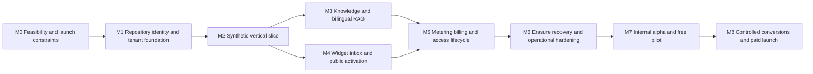

# Sema — Implementation Plan

Version 1.0 · 16 October 2026 · Dependency-ordered delivery baseline

Build against the [PRD](sema-production-prd.md), [system design](sema-system-design.md), [logical model](sema-data-model-and-flows.md), [technical design](sema-technical-design.md) and [stack specification](sema-tech-stack.md). This plan decomposes TD-01–TD-08 into concrete milestones. Tasks below are planned work; the existing checked schema and contract descriptors do not implement the application.

## 1. Delivery approach and dependencies

Deliver a safe end-to-end slice before filling out all screens. Prove the stack's difficult constraints before investing in full UI polish. Privacy and billing invariants ship with their domains. Use local synthetic tests first; hosted evaluation, payment, email and load checks require the appropriate accounts, data controls and authorized scope.



Arrows represent required integration order. Some tasks may overlap, but the founder operating model does not imply multiple engineers or reviewers are available. Integrate one domain at a time if working solo. Backups, erasure design and legal review begin in M0; M6 proves the complete assembled system.

## 2. Milestones and acceptance evidence

### M0 — Resolve technical and operating feasibility

**Maps to:** TD-01; feasibility portions of TD-04/TD-07; PRD G0/G1 and open decisions O03–O09.

| Task | Deliverable | Acceptance / stop condition |
|---|---|---|
| IMP-001 Dependency and hosting spike | Minimal Next.js + Convex + Better Auth + Netlify integration; committed lockfile and supported runtime matrix | Clean install/build on selected Node; real staging sign-up/login/reset/sign-out, SSR and revoked-session checks. Record adapter/compiler/component versions. Peer-range compatibility alone is insufficient. |
| IMP-002 Free-plan and vendor review | Dated account-specific limits, commercial terms, processor/region/retention map and spend settings | Verify no unauthorized paid fallback/recharge; staging and production isolation fit account entitlements. Record DPA/transfer and vendor deletion gaps. |
| IMP-003 Hostile ingestion proof | TXT/PDF/DOCX bounded parser/scanner and public-page fetch prototype | Demonstrate isolation, memory/time limits, malformed/zip-bomb rejection, SSRF/redirect defenses and private-file handling. If the chosen free runtime cannot provide this, resolve a material provider/scope/funding change before enabling document imports. |
| IMP-004 Bilingual model proof | Small representative en/sw source-and-question benchmark with measured model/embedding usage | Confirm actual embedding dimension and support, grounded cross-language answers, abstention, citations and latency. A provider model card does not prove Sema's quality. |
| IMP-005 Recovery and privacy proof | Isolated restore exercise including identity, files, keys/configuration, later erasure journal and ledger | Demonstrate that deletion cannot be undone by restore; disclose measured RPO/RTO. Select an independently protected free journal/snapshot arrangement or return the material funding decision. |
| IMP-006 Commercial and legal readiness | Seller/receipt details, approved tax/fee quote rules, privacy notices, sector screening and review owners | No production visitor data or paid checkout before applicable reviews. Tax and processing fees must be shown in the final authorized total. |

**Exit:** evidence supports G1, all blocking infrastructure/privacy constraints are resolved, and at least three eligible businesses' pilot commitments and representative content support G0. This outreach/validation work is not permission to restrict public self-service to invited businesses.

### M1 — Establish the repository and security foundation

**Maps to:** TD-01/TD-02; all SEC controls begin here.

| Task | Deliverable | Acceptance evidence |
|---|---|---|
| IMP-007 Repository bootstrap | pnpm workspace repository (`apps/web`, `packages/ui`), exact reviewed dependencies, root `pnpm-lock.yaml`, `packageManager`/runtime pins, environment templates, CI checks | Extend the existing scaffold and adopt [delivery templates](sema-delivery/README.md); `pnpm install --frozen-lockfile` and clean CI without production secrets. Review `allowBuilds`; reject missing tests/scripts, do not skip checks with `--if-present`. |
| IMP-008 Schema adoption | Existing physical schema adapted to actual generated Convex types and mounted components | Structural checks pass; no duplicate auth schema; semantic integer/bounds/state validators and public DTO review pass. |
| IMP-009 Authorization layer | Shared current-session, role, parent-resource, operator and visitor guards | Tenant-negative matrix covers every public entry point and referenced object; revoked membership/session loses access within PRD ceilings. |
| IMP-010 Domain transaction helpers | Command receipts, effect keys, revisions, clock abstraction and safe error taxonomy | Concurrent duplicate commands create one canonical effect; conflicting replay payloads fail. Realism limits of in-memory tests are recorded. |
| IMP-011 Provider ports and diagnostics | Model/payment/mail/file adapters, synthetic fixtures, safe correlation IDs and redaction | Unit/domain suites run without external secrets; test adapters cannot be enabled accidentally in deployed production. |

**Exit:** tenant foundation works in staging and CI. No customer-facing AI or live payment feature is enabled.

### M2 — Build a synthetic vertical slice

**Maps to:** TD-03/TD-05; a deliberately narrow internal integration milestone.

Implement one owner, a manual FAQ draft, preview/publication, verified test-site activation, a visitor turn with deterministic model adapter, one persisted answer with one debit, human handoff and one agent reply. Add the state checks and transaction boundaries now rather than stubbing them for later.

| Task | Acceptance evidence |
|---|---|
| IMP-012 End-to-end slice | Browser journey completes with synthetic data and explicit English/Swahili UI selection. Accepted messages remain after reconnect. |
| IMP-013 Race and failure slice | Handoff during generation suppresses commit; duplicate send yields one answer/debit; token expiry releases hold; cross-tenant IDs are denied. |
| IMP-014 Deployment rehearsal | Isolated backend expansion followed by Netlify build/adapter deployment and smoke test; record both service IDs and safely recover from frontend failure. |

**Exit:** the system's main integration path works. A fake-model demonstration does not satisfy bilingual or real-provider launch gates.

### M3 — Complete knowledge management and bilingual RAG

**Maps to:** TD-04/TD-05; PRD knowledge FRs and §7.

| Task | Deliverable and acceptance evidence |
|---|---|
| IMP-015 Supported ingestion | Manual FAQ, TXT, text PDF, DOCX and one public webpage per import. Safe quarantine, cancellation, status/errors, limits and retries tested. No OCR, whole-site crawl or auto-sync. |
| IMP-016 Immutable publication | Owner preview in both languages plus explicit publish, version history and unpublish. Draft changes invalidate prior preview; atomic pointer prevents mixed corpora. Stale generation cannot finalize after revocation. |
| IMP-017 Retrieval and validation | Versioned chunking/embedding, scoped vector/text search, evidence checks, prompt-injection defense, conflict handling and citation validation. No external tools/actions by FAQ AI. |
| IMP-018 Answer orchestration | Fair admission and budget reservation, absolute deadline, provider timeout, validation/finalization, fallback/handoff, hold release and cleanup | 
| IMP-019 Held-out evaluation | Versioned gold dataset, bilingual human rubric, raw counts/per-language results, disagreements adjudicated and regression report. Meet PRD §7.4, including recall@5 ≥90% each language, grounded precision ≥95%, valid citations 100%, correct abstention ≥95% and human takeover 100%. Also enforce correctness, coverage and language-quality thresholds. |

**Exit:** evaluated real model and retrieval pipeline pass on the approved held-out set. Review coverage as well as precision to prevent an always-abstain system from appearing successful. No tuning on held-out answers without creating a new held-out evaluation.

### M4 — Finish visitor support and immediate public activation

**Maps to:** TD-03/TD-05.

| Task | Deliverable and acceptance evidence |
|---|---|
| IMP-020 Widget | Deferred lightweight loader, isolated iframe, exact origins, language controls, safe session handling, accessible mobile conversation and reconnect/history behavior. Meet PRD embed size and client targets. |
| IMP-021 Inbox and human state | Paginated inbox, durable handoff queue, single-winner claim, live staff reply, internal notes, hours/expiring availability and conversation resolution. Staff-only data never reaches visitor DTOs. |
| IMP-022 Away capture and notifications | Honest away copy, optional contact capture and minimal queued email. No transcript/phone in alert; a mail failure leaves the handoff intact. |
| IMP-023 Workspace management | Owner plus one agent, invite/revoke/transfer safeguards, branding, attribution, one-site enforcement and business-managed source maintenance. |
| IMP-024 Public go-live | Public sign-up → immediate bounded imports/preview/publication → site check → automated readiness → activation. Enforce initial-pilot offer version and atomic clock start at verified go-live. Test enrollment closure and later paid-before-live behavior. |
| IMP-025 Resource fairness | Per-tenant/global ingestion, preview, generation and file limits; expiry of abandoned setup data; transparent capacity feedback; no required appointment or founder approval. |

**Exit:** public activation works within tested capacity and both supported languages, with included assistance available afterward. Founder support remains scheduled appointments and best-effort asynchronous support.

### M5 — Complete commercial correctness and access lifecycle

**Maps to:** TD-06; PRD §8. All prices below are base amounts, with applicable disclosed tax/fees added before authorization.

| Task | Deliverable and acceptance evidence |
|---|---|
| IMP-026 Allowance and reservation ledger | Pilot 100 total units; Starter KES 2,500/1,000 units per service month; top-up KES 500/100 units/90 days. Included first, packs earliest expiry, no included rollover, original pack expiry preserved. Concurrent last-unit tests and counter/ledger reconciliation pass. |
| IMP-027 Checkout and IntaSend adapter | Immutable final quote, owner authorization, safe STK initiation, ambiguous-timeout resolution, callback validation and authoritative status lookup. Sandbox covers duplicate/out-of-order events, mismatches and delayed settlement after erasure. |
| IMP-028 Period and renewal logic | Manual monthly M-Pesa renewal, calendar boundaries, early conversion, cancellation at period end, reminders and no autopay. Time-zone/month-end/leap-year tests use fixed clocks. |
| IMP-029 Exhaustion and expiry | AI/human/grace/read-export/purge state matrix matches PRD. Test exact boundaries with delayed jobs; static contact fallback when Sema is available. |
| IMP-030 Corrections and retained credit | Duplicate/error money refunds, incorrect-count credit corrections, expired-pack review, receipt records and minimal financial retention. Same verified owner reactivation creates an empty workspace with original valid pack expiry. |
| IMP-031 Economics and fees | Measured complete-allowance infrastructure, previews/failures, payment fees, taxes and founder assistance effort | 

**Exit:** sandbox and controlled operational tests prove the accounting and access rules. Real collections remain disabled until G4 prerequisites. Two verified Starter conversions are collected afterward, not required before the first valid checkout can occur.

### M6 — Prove privacy, recovery and operations end to end

**Maps to:** TD-07; SEC and NFR suites.

| Task | Deliverable and acceptance evidence |
|---|---|
| IMP-032 Export and erasure | Authenticated private export with expiry; 90-day conversation retention/30-day option; earlier erasure, inactive-workspace cleanup and provenance-based linked-copy deletion. Test original files, vectors, notes, contact, feedback/gaps, workflow payloads and diagnostic leakage. |
| IMP-033 Recovery drill | Restore complete staging state in quarantine, reapply later tombstones/revocations, reconcile provider payments and canonical balances, release orphan holds and rebuild safe jobs. Never replay old STK or erased content. Record actual recovery bounds and file/component coverage. |
| IMP-034 Abuse/security hardening | Threat-model review, SSRF, injection, file attacks, role escalation, revoked-session, origin/CSRF and rate-limit tests; no unresolved exploitable high/critical finding. |
| IMP-035 NFR evidence | Nairobi/mobile latency, ingestion, connection/concurrency, authorized load, browser/accessibility and widget-weight reports against NFR-01–12. Document workload and failures. |
| IMP-036 Operations and incident drills | Safe metrics, quota alerts, payment mismatch and erasure backlog alerts, kill switches, outage/contact runbooks, secret rotation, backup ownership and founder notification tests. Independently verify alerts can reach the founder. |

**Exit:** no reliance on undocumented manual heroics for privacy or accounting. Technical capacity cannot substitute for required legal/vendor reviews or qualified bilingual review.

### M7 — Internal alpha and initial public free pilot

**Maps to:** TD-08; PRD G2/G3.

| Task | Deliverable and acceptance evidence |
|---|---|
| IMP-037 Alpha evidence review | Trace every applicable FR/SEC/NFR and DM-01–DM-28 scenario to a real test/report, owner and result. Missing evidence fails the gate. |
| IMP-038 Pilot readiness | Initial offer version, 30-day/100-answer terms, public capacity policy, notices, owner help, named business agents and included-assistance boundaries published. Test payment/refund plumbing only in an authorized test workspace. |
| IMP-039 Observe actual pilot | Closely observe at least three representative eligible businesses while public self-service remains open within transparent limits. Audit grounded answers, Swahili outcomes, handoffs, usage, support demand and capacity. |
| IMP-040 Pilot enrollment closure | Versioned control stops new free enrollment, preserves existing accepted terms, and requires later customers to pay before live activation. Closure date is an operator decision based on evidence, not an invented fixed date. |

**Exit:** release G3 only when readiness passes. Pilot traffic and elapsed time alone do not imply quality or commercial validation. Extend observation if too few genuine questions arrive.

### M8 — Controlled conversions, broad paid launch and follow-up

**Maps to:** PRD G4/G5; WhatsApp remains G6 later.

| Task | Deliverable and acceptance evidence |
|---|---|
| IMP-041 G4 review and controlled conversion | Pass current quality/security/privacy/billing/refund/deletion/recovery/terms/NFR/economics prerequisites and tax/fee terms. Record founder approval; owners explicitly authorize each purchase. |
| IMP-042 G5 evidence | At least two distinct eligible pilot businesses settle non-refunded Starter purchases; exclude founder/test accounts, duplicate businesses and top-up-only purchases. At least 100 audited substantive pilot answers across the cohort; all launch P0/P1 defects closed; other G4 gates remain valid. |
| IMP-043 Launch operations | Release record, measured capacity, installation/help docs, renewal reminders, support appointments and rollback drill ready. Broad launch flag changes only after evidence review. |
| IMP-044 Post-launch review | Review actual usage and renewal cohorts; evaluate expansion around measured 10/25/50 paid workspaces without promising those capacities on free tiers. Reprioritize roadmap from paid demand. |

## 3. Estimation and ownership

There is no validated delivery date or confirmed engineering team capacity. The PRD's roughly 8–12 engineering-week build estimate is a planning assumption, not a solo-founder deadline. As a starting allocation of that implementation effort: M0 15%, M1–M2 20%, M3–M4 25%, M5 15%, M6 15%, M7 preparation 10%. Re-estimate after M0 and M2; unresolved isolation/recovery/legal work can materially expand it. The free pilot then runs 30 days for each enrolled business from its own go-live; overlapping enrollments and insufficient traffic can extend cohort observation. G4/G5 dates depend on evidence and willing customers.

The founder is accountable for product scope, vendor accounts, public notices, business assistance, commercial approval and releases. Engineering implementation ownership must be assigned when execution begins. Qualified bilingual, security/privacy and finance/legal review must be arranged where required; do not invent staffed roles or assume the founder's sign-off supplies specialist evidence. CI automation reduces repeated work without replacing those reviews.

## 4. Issue and evidence contract

Each IMP task becomes an issue containing its parent milestone, referenced PRD IDs/DM cases, dependencies, implementation owner, acceptance criteria, privacy/cost impact, test strategy, rollback/migration note and evidence links. Avoid one issue per table or screen; cut work around complete user outcomes and invariants.

Definition of done: implemented and reviewed code; applicable meaningful tests; passing CI; no secret/content leakage; compatible deployment/migration path; documented errors and metrics; bilingual/accessibility evidence when user-facing; updated requirements/decision record; actual staging proof when the task crosses a service boundary. A skipped test or absent report cannot be labeled passing. Design-only checks must remain labeled as such.

Suggested evidence layout:

```text
release-evidence/<candidate-sha>/
  test-summary.json
  authorization-and-isolation.md
  bilingual-evaluation.json
  payment-reconciliation.md
  deletion-and-recovery.md
  performance-accessibility-and-capacity.md
  vendor-privacy-and-economics-review.md
  migrations-and-rollback.md
  release-manifest.json
```

Store sensitive evidence privately with access/retention controls; publish only sanitized summaries. Record environment, code SHA, lockfile digest, model/prompt/embedding/dataset versions, measurement conditions, raw counts, reviewer, timestamp and unresolved risks. Unaffected evidence may be carried forward only with an explicit applicability review; security, authorization, money, lifecycle and model/corpus changes require their relevant regression evidence.

## 5. Scope guardrails

Do not add WhatsApp, OCR/crawling, bookings or transactional agents, automatic M-Pesa renewal, a third staff seat, white-label/multi-site agency support, mandatory founder activation approval, or automatic paid infrastructure to finish MVP. Those require their own decision and evidence gates. Implementation may simplify internal modules but must preserve confirmed user-facing requirements and launch prerequisites.
