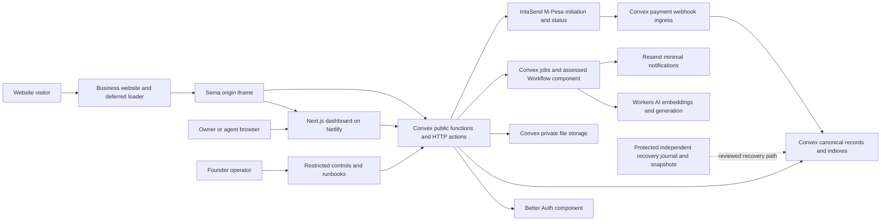

# Sema — System Design

Version 1.0 · 16 October 2026 · Proposed implementation baseline

Sema answers approved business FAQs in English and Swahili and hands conversations to the business's own staff. This document defines runtime boundaries, trust, consistency, deployment and failure behavior. It complements the [PRD](sema-production-prd.md), [logical model and flows](sema-data-model-and-flows.md), [technical design and physical schema](sema-technical-design.md), [stack specification](sema-tech-stack.md), [implementation plan](sema-implementation-plan.md) and [CI/CD specification](sema-ci-cd.md). The PRD governs product behavior; physical validators alone do not implement that behavior.

## 1. Decision and evidence status

| Status | Meaning in this design |
|---|---|
| Confirmed product decision | Website first; non-regulated services; en/sw; immediate public self-service; optional assistance; published knowledge only; two staff seats; confirmed pilot, Starter, top-up and retention policies in the PRD. |
| Adopted architecture, subject to proof | Next.js/Netlify, Convex primary backend, Better Auth integration, Workers AI, IntaSend and Resend. These choices are not evidence of account eligibility, security, privacy or sufficient free capacity. |
| Proposed engineering default | Modules, transaction boundaries, environment layout, failure controls and operational targets below. Routine implementation choices are delegated. |
| Locally verified design artifact | The existing schema package compiles and its structural checks pass. It contains 40 physical tables and contract validators, without executable application handlers. |
| Unproven launch prerequisites | End-to-end stack compatibility, hostile-file isolation, bilingual model quality, actual provider terms/configuration, complete recovery, paid settlement/refunds and free-tier workload capacity. |

No positive recurring infrastructure budget or automatic paid fallback is authorized. Material scope, privacy or funding constraints must be returned to the founder with measured options. Firecrawl is the research tool used for these documents; it is not a new Sema runtime dependency.

## 2. Runtime topology and ownership



The recovery box describes a required capability, not a provisioned vendor. Its free, private, independently protected implementation is a feasibility gate. Do not store the only deletion journal inside the snapshot it must correct.

| Container / module | Owns | Boundary |
|---|---|---|
| Netlify / Next.js | Marketing, registration UI, owner/agent dashboard, localized widget UI, deferred loader and required framework/auth routes | No canonical balances or tenant authorization in browser state. Keep provider credentials out of public bundles. |
| Convex identity and access | Current authenticated session, membership, roles, two-seat limit, invitations, operator permissions, visitor-token guards | Every public function and subscription must authorize its actual caller and requested resource. An organization ID from a client grants nothing. |
| Workspace and activation | Site ownership/origin checks, branding, hours, readiness, offer enrollment and service state | Automated readiness checks permit immediate self-service activation. There is no mandatory founder setup queue. |
| Knowledge and retrieval | Source versions, import jobs, immutable candidate corpora, preview evidence, publication pointer, scoped search | Processing or saving drafts never publishes. Only the owner publishes an approved version after required previews. |
| Conversation and support | Accepted turns/messages, inbox, presence, claims, handoff, optional contact capture, private notes | Staff replies and internal notes have separate DTOs. AI stops on takeover. |
| Answer orchestration | Admission, retrieval, model call, validation, final transactional commit | Model output is an untrusted candidate. No unvalidated answer streaming to the visitor. |
| Commercial domain | Quotes, payment attempts, verified settlements, service periods, unit reservations, ledger and packs | Money and answer credits are separate ledgers. Model/provider success alone cannot debit the customer. |
| Lifecycle and operations | Retention, erasure, exports, reconciliation, budget controls, diagnostics and recovery | Actual time and tombstones enforce access; delayed jobs cannot extend access or resurrect content. |

Use modules in one backend deployment initially, with domain functions behind explicit guards. Do not create separate microservices for each domain. Use bounded actions/jobs for external I/O and transactional mutations for state transitions. Convex actions do not turn an external call and a database write into a single transaction. See [Convex actions](https://docs.convex.dev/functions/actions) and [transaction/OCC behavior](https://docs.convex.dev/database/advanced/occ).

## 3. Interfaces and trust boundaries

| Entry | Authentication and authorization | Minimum protections |
|---|---|---|
| Staff query/mutation/action | Current Better Auth session plus current active membership/role | Object-level tenant checks, schema and semantic bounds, explicit safe result DTO, audit sensitive changes. |
| Visitor conversation API | High-entropy token stored as a hash, scoped to site/conversation/session, expiry and current service state | Rate/size limits, replay keys, exact origin policy, no staff-only fields. An origin header or public widget key is not a visitor identity. |
| Widget embedding | Registered production site with verified handshake and exact allowed origins | HTTPS, iframe isolation, narrow CSP/frame policy, validate `postMessage` origin and message schema, never pass staff credentials to the host page. |
| Knowledge upload/import | Owner permission, resource reservation, quarantine status | Size/type/content limits, private storage, malware and parser isolation proof; webpage SSRF controls on every redirect and resolved destination. |
| Payment webhook | Provider validation mechanism plus independent authoritative status lookup | Reject environment/merchant/reference/amount/currency mismatch; durable deduplication; do not trust browser redirect success. |
| Export/private file route | Current session, tenant and parent permission, live asset grant and expiry | Return bytes with safe download headers and `private, no-store`. Native file URLs are bearer links, not a substitute for private authorization. |
| Internal scheduled work | Internal function plus expected organization generation and object version | Idempotent effect key; recheck authority/state before writes or external effects; bounded retries and dead-letter visibility. |
| Operator route | Explicit allowlisted operator identity and strengthened account access | No ordinary customer role can operate global controls. Minimize content access and audit exceptional access. |

Visitors select English or Swahili; mixed-language questions may be interpreted within tested coverage. Do not silently promise additional languages or Sheng quality. Source language may differ from response language. Both languages must meet their own held-out quality gates.

## 4. Canonical state and consistency

Convex is the source of truth for workspace state, published corpus, conversations, payment facts and usage effects. The separate Better Auth component owns its identity records; do not duplicate its internal schema into Sema tables. The physical design maps 54 logical records to 40 tables, including a technical command-receipt table. Adoption requires actual guards and handlers, not merely schema deployment.

| Invariant | Implementation rule |
|---|---|
| Tenant isolation | Resolve the authorized tenant from current identity/binding; verify every referenced parent. Search partitions include tenant, corpus and embedding version, followed by eligibility checks. |
| Uniqueness and retries | Check indexed command/effect keys and insert/update in one mutation. Convex indexes do not supply SQL unique constraints. Same request key and same payload returns the original result; conflicting payload is rejected. |
| Message durability | Acknowledge only a persisted accepted message. Reconnect reads canonical sequence/cursor state; delivery retries do not duplicate accepted turns. |
| Publication | Immutable corpus manifest plus atomic published-pointer update. Editing candidate inputs invalidates preview evidence. Immediate unpublish/delete increments knowledge revision and revokes retrieval eligibility. |
| Human takeover | Claim/handoff increments conversation mode revision. One claimant wins transactionally; an older AI candidate cannot commit afterward. |
| Usage | Atomically reserve eligible included units, then earliest-expiring packs. Commit one substantive message and one debit together; otherwise release the reservation. No billing for greetings, fallback, clarification-only, failed attempts, preview or human replies. |
| Money | Provider lookup confirms a unique settled financial effect. A duplicate callback cannot extend a subscription or mint another pack. Preserve facts even if the operational workspace has been erased. |
| Lifecycle | Effective access is computed from timestamps and state, including expiry/grace/read/export deadlines. Schedulers perform cleanup; they never determine whether expired access is still permitted. |
| Deletion | Tombstone and generation change precede purge batches. New work and stale jobs fail closed. Restore reapplies later erasures before exposing recovered records. |

Do not rely on broad realtime subscriptions for correctness. Page inbox/message history, subscribe to narrow safe summaries and load details on demand. Separate hot capacity counters from widely subscribed organization configuration to reduce invalidation and contention.

## 5. Critical runtime flows

### 5.1 Approved FAQ answer

```mermaid
sequenceDiagram
  participant V as Visitor
  participant M as Convex mutation
  participant A as Answer action/job
  participant P as Workers AI
  V->>M: Send turn with replay key and session token
  M->>M: Authorize, persist turn, check budget, reserve one unit
  M-->>V: Accepted turn ID
  A->>M: Read current corpus, mode and authority
  A->>P: Minimum eligible evidence and question
  P-->>A: Untrusted candidate
  A->>A: Validate grounded answer and citations
  A->>M: Finalize with expected revisions and reservation
  M->>M: Recheck time, token, mode, corpus, access and credit
  alt Still valid and substantive
    M->>M: Persist answer and debit exactly once
    M-->>V: Committed answer becomes retrievable
  else Stale, invalid, timed out or takeover
    M->>M: Release hold; record safe fallback/handoff when permitted
    M-->>V: Safe outcome without customer debit
  end
```

One absolute 20-second answer deadline includes queueing, retrieval, provider call and validation. Queue wait is at most 10 seconds; generation is at most 15 seconds and always bounded by time remaining. A 60-second cleanup lease does not extend the visitor deadline. If the original visitor token expires mid-generation, discard the candidate and release its hold; do not charge for an answer the original session cannot retrieve. Never reuse stale authorized evidence after publication, deletion, tenancy or mode changes.

### 5.2 Knowledge publication

Reserve source capacity → accept private quarantined upload or bounded public-page fetch → scan/extract in a proven isolated environment → normalize/chunk/embed → assemble immutable candidate → owner previews in both languages → explicit owner publish after revision checks. Imported documents and page instructions are untrusted content. Retrieval never grants them tool authority. If malicious-file isolation cannot be proved within the selected free infrastructure, resolve that scope/provider/funding decision before enabling those launch formats; do not quietly remove a confirmed format or run an unbounded parser in the main runtime.

### 5.3 Handoff and unavailable agents

An explicit human request creates a durable handoff immediately and suppresses AI. Show availability only during configured business hours with an available signed-in agent. A transactional claim selects one responding staff member. Outside those conditions, show an honest away message, offer optional contact capture, retain the handoff and queue a minimal email alert. A failed email does not lose the request or revert it to AI. Agent presence is advisory and must expire; acceptance into the inbox is durable.

### 5.4 Checkout and settlement

Owner reviews an immutable quote showing base price, applicable tax, processing fee and final KES total → confirms payment → server records an attempt before STK initiation → provider call → verified callback/status reconciliation → unique settlement effect updates period or pack. On an ambiguous timeout, reconcile the existing attempt rather than blindly initiating another STK. Only a current authorized owner can initiate payment. A later settlement can be recorded on the retained financial account after content erasure; it must not resurrect erased content.

Starter is KES 2,500 base for 1,000 included replies per service month. Top-ups are KES 500 base for 100 replies, expiring 90 days after purchase and usable only during active paid service. No automatic debit or automatic top-up. Monthly calendar and integer-money rules remain as specified in the technical design.

### 5.5 Public activation and lifecycle

Registration and bounded import/preview are immediately self-service. Readiness checks cover eligibility, owner contact, allowed site, published previewed corpus, bilingual checks, notice/consent configuration, plan eligibility and platform headroom. During the initial pilot phase, verified production go-live starts the 30-day/100-answer offer atomically. Later registrants pay Starter before go-live; registering early does not reserve the free offer.

Pilot exhaustion pauses AI while human chat continues to day 30. Paid quota exhaustion pauses AI while human chat remains available within paid access. Paid expiry stops AI immediately, provides three days of human-chat grace, then 30 days of read/export. Pilot expiry has no live grace and provides its own 30-day read/export period. After the appropriate window, erase workspace content and retain only justified minimal financial/unexpired-credit records. Reactivation creates an empty workspace with original unexpired pack validity.

## 6. Failure and degraded-service matrix

| Failure | Required behavior | Detection / recovery |
|---|---|---|
| AI outage, invalid evidence or model daily cap | Stop AI admission, offer fallback/handoff; preserve human service if backend healthy; release holds | Separate AI success/latency from general widget success; manual reset only after headroom and recovery verified. |
| Convex outage or hard backend quota | Fail clearly without false acknowledgement or payment-success claims | Business keeps contact details on its own website. An API failure cannot guarantee a dynamically loaded Sema contact card. |
| Netlify outage or credit pause | Dashboard/widget assets may be unavailable | Independent contact path and operator runbook; no claim that Convex health alone makes the widget usable. |
| Ingestion/scanner outage | Leave source private and unpublished; bounded retry, visible failure | Job age alert; preserve the currently published corpus. |
| Resend outage/daily cap | Keep durable handoff in inbox; queue bounded notification retry without transcript | Email cannot be the only durable queue. Prioritize account-security mail and avoid promising delivery beyond provider capacity. |
| Payment webhook missing or repeated | Reconcile authoritative provider state; apply each financial effect once | Poll/reconciliation cadence respects limits; unresolved mismatch alerts founder; no guessed payment success. |
| Deployment succeeds only on backend | Keep old frontend compatible; do not open new feature gate | Halt release, inspect migration state, forward-fix or redeploy a compatible backend. |
| Source deleted or human claims during model call | Reject candidate commit | Revision/mode checks; release hold; never send stale tokens to browser. |
| Cleanup delayed | Access still expires on time; report backlog | Idempotent batches recover; monitor erasure deadlines and verify residual copies. |
| Disaster restore | Quarantine, reapply later tombstones, reconcile money, revoke stale grants | No outbound STK/email/chat replay until recovery checks pass. Code rollback is not a content restore. |

## 7. Capacity and nonfunctional targets

The PRD's NFR-01–NFR-12 remain authoritative. Pilot tests target five simultaneous AI generations and 50 realtime connections across up to five synthetic tenants, not a promise of that free production capacity. Measure browser acknowledgement p95 ≤1 second, validated answers p95 ≤10 seconds/p99 ≤20 seconds and small supported-source ingestion p95 ≤5 minutes under documented conditions. Nairobi mobile-network measurements, accessibility and supported-browser evidence are required; local timing is insufficient.

Size admission from measured usage: function calls per accepted turn and subscription update; action GB-hours; database bytes including indexes and evidence; file plus backup bytes; vector-index growth; neurons per answer/import/preview; notification volume; deployment/build credits. Use conservative margins and per-tenant fairness. Keep emergency headroom for identity, payment reconciliation and erasure. A proposed initial warning is 60% of a verified hard quota and new heavy-work suspension at 80%, adjusted downward when measured bursts demand it. This is an engineering starting point, not a way to guarantee the vendor's hard cap will never interrupt service.

Model preview and failed attempts are free to customers but consume infrastructure capacity. Reserve their own bounded budgets. Public self-signup does not promise unlimited total imports, previews or simultaneous activations. Show an honest capacity limit and retry path rather than adding a founder approval queue. Do not automatically upgrade providers or change models when free quotas run out.

## 8. Deployment, recovery and observability

Use synthetic local CI, a separately configured synthetic staging environment if the free account permits it, and production. No preview uses the production database, identity configuration, credentials or visitor records. Free quotas may be shared across environments. Disable automatic per-PR hosted deployments by default; enable a trusted preview only with measured quota allowance and complete isolation. Netlify supports Next.js through its [OpenNext adapter](https://docs.netlify.com/build/frameworks/framework-setup-guides/nextjs/overview/); a successful `next build` alone does not prove the transformed deployment.

Deploy backward-compatible Convex expansion first, complete required bounded backfills and index readiness checks, then deploy the frontend. Record the actual adapter, package lock, build, backend and frontend IDs. Treat model/prompt/embedding/publication changes as versioned releases with evaluation evidence. The [CI/CD specification](sema-ci-cd.md) defines code promotion and rollback; these services are not an atomic distributed deployment.

Propagate safe correlation IDs across turn, action/job, provider attempt and ledger effect. Monitor unauthorized access, unsafe-answer reports, mismatched payment facts, reservations past lease, job backlog, access/deletion lag, reconciliation differences, provider headroom and widget/AI success separately. Do not log source text, visitor tokens, payer phones, credentials or transcript-bearing email payloads. Metrics are minimized operational records, not an alternate transcript store.

Before real visitor data, prove a complete restore involving application records, component identity/rebinding, files, configurations, keys, erasure journal and safe job reconstruction. The pilot engineering target is a daily recovery point with achieved bounds documented and disclosed. Future RPO ≤1 hour/RTO ≤4 hours remains conditional on proof and funding. A free manual table backup alone does not meet this requirement. Founder best-effort support is unchanged; this design does not assume a staffed 24/7 team.

## 9. Review decisions before implementation

1. Complete the feasibility evidence in implementation milestone M0. Preserve selected architecture only where it passes the required checks.
2. Adopt the domain boundaries and invariants above and reuse the checked physical schema as a starting point.
3. Implement one synthetic vertical slice before broad feature work: register → publish FAQ → activate test site → answer → handoff → canonical usage.
4. Implement privacy, billing and failure behavior alongside their owning domains, not as a launch-week add-on.
5. Keep G3 pilot, G4 controlled conversions and G5 broad paid launch as separate capability gates. Two distinct settled Starter conversions are required for G5, after G4 prerequisites enable those conversions.

This is a design baseline, not evidence of a deployed, load-tested or privacy-approved production system.
