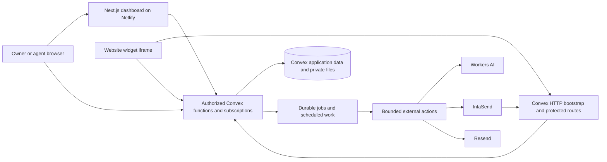

# Sema — Technical Design

**Version:** 1.0  
**Date:** 16 October 2026 (Africa/Nairobi)  
**Product baseline:** [PRD v2.1](sema-production-prd.md)  
**Logical model:** [Data model and flows v1.0](sema-data-model-and-flows.md)  
**Stack snapshot:** [Tech stack specification v1.0](sema-tech-stack.md) — dated dependency candidates and integration checks  
**Status:** Implementation blueprint with a concrete physical schema and API validators. No application handlers, authentication integration, provider accounts or deployed infrastructure have been implemented.

The PRD defines the product contract. This document resolves physical storage, module boundaries, authorization, transactions, processing and deployment design under the founder's engineering delegation. It maps the earlier 54 logical record types into 39 application tables, then adds one technical command-receipt table: **40 physical tables in one Convex backend**. Product prices, entitlements, pilot terms and privacy requirements remain unchanged.

## Contents

1. [Deliverables and design status](#1-deliverables-and-design-status)
2. [Runtime architecture](#2-runtime-architecture)
3. [Physical Convex schema](#3-physical-convex-schema)
4. [Identity and authorization](#4-identity-and-authorization)
5. [Backend contracts and errors](#5-backend-contracts-and-errors)
6. [Transactions and idempotency](#6-transactions-and-idempotency)
7. [Knowledge processing and publication](#7-knowledge-processing-and-publication)
8. [Answering and human takeover](#8-answering-and-human-takeover)
9. [Commercial lifecycle and payments](#9-commercial-lifecycle-and-payments)
10. [Background jobs and resource control](#10-background-jobs-and-resource-control)
11. [Deletion and recovery](#11-deletion-and-recovery)
12. [Deployment and operations](#12-deployment-and-operations)
13. [Verification and implementation backlog](#13-verification-and-implementation-backlog)
14. [Technical references](#14-technical-references)

## 1. Deliverables and design status

| Artifact | Purpose | Actual status |
|---|---|---|
| [Physical schema](sema-technical-design/convex/schema.ts) | Concrete tables, field validators, references and indexes | Type-checked and instantiated locally with the official Convex SDK; not deployed |
| [Constants](sema-technical-design/convex/constants.ts) | Confirmed offer constants plus delegated resource/time limits | Concrete design inputs; provider capacity and model performance unproven |
| [Public contracts](sema-technical-design/contracts/public.ts) | Core operation argument/result validators and required access classifications | Type-checked; descriptors do not register or authorize any endpoint |
| [Model mapping](sema-technical-design/physical-model.json) | All 54 logical record types mapped to physical storage, plus technical-only receipt table | Complete mapping for review; embedded-validator expressions document schema shapes |
| [Verification report](sema-technical-design/verification.json) | Local checks and explicit limits of those checks | Reports schema/contract checks, not working product behavior |
| [Bundle guide](sema-technical-design/README.md) | How to review and adopt the files | Contains local checking instructions; no deployment scripts |

The verified local compiler result is **Convex 1.47.0 with TypeScript 7.0.2**. This identifies the check performed; it is not a tested Next.js/Better Auth/Netlify compatibility matrix or an indefinite production-version recommendation. Pin supported patched application versions during the foundation spike and record a lockfile.

A field validator establishes a stored value's shape. It does **not** establish tenant authorization, unique business keys, integer bounds, valid phone numbers, permitted transitions, array-length limits or a passing model evaluation. Those requirements are defined below and belong in tested domain handlers.

## 2. Runtime architecture

### 2.1 Responsibility boundaries



The diagram groups responsibilities; it does not add services. Better Auth/Workflow components use their assessed Convex integration and component-managed storage. Sema does not copy their internal schema into the application schema. No second application database, PartyServer, general message broker or separate Inngest service is introduced.

| Runtime | Owns | Must not own |
|---|---|---|
| Next.js / Netlify | Dashboard, widget assets/iframe, login integration, server-rendered navigation and presentation | Canonical usage/payment state; background ingestion; plaintext provider secrets in browser bundles |
| Convex queries | Authorized, bounded projections and reactive reads | Writes, network calls, implicit authorization through a client tenant ID |
| Convex mutations | Atomic state transitions, reservations, messages, ledger effects and job scheduling | External API calls or long document processing |
| Convex default-runtime actions / HTTP actions | Bounded fetch integrations, public bootstrap, protected file transfer and webhook entry | Assuming a series of DB calls is one transaction |
| Convex Node actions | Vetted document libraries or controlled DNS/HTTPS fetching requiring Node APIs | Queries/mutations in a Node-only file; arbitrary child processes or an assumed antivirus daemon |
| Workflow / scheduler | Durable orchestration and wake-ups | Sole copies of pending business state or private transcripts in workflow arguments |

Convex distinguishes deterministic queries/mutations from actions and provides an opt-in Node runtime for action-only code. Keep Node-only parsing/fetch helpers in their own import graph. Next.js on Netlify also needs adapter-specific integration testing. [Convex runtimes](https://docs.convex.dev/functions/runtimes), [Netlify Next.js support](https://docs.netlify.com/build/frameworks/framework-setup-guides/nextjs/overview/).

### 2.2 Proposed application layout

```text
apps/web/                     @sema/web; Next.js and future backend integration
  src/app/                    dashboard, auth routes, owner/agent screens
  src/widget/                 small loader and isolated visitor UI
  convex/
    schema.ts                 application schema supplied with this design
    constants.ts              supplied constants; no secrets
    convex.config.ts          assessed auth/workflow components, added during spike
    auth.ts, http.ts, crons.ts integration and explicit HTTP/scheduled entry points
    workspaces.ts, members.ts, activation.ts, settings.ts
    knowledge.ts, inbox.ts, visitor.ts, presence.ts
    billing.ts, privacy.ts    deliberately exported public functions
    internal/                 privileged worker queries/mutations/actions
    domain/                   pure access, billing calendar, metering, publication rules
    guards/                   current actor, tenancy, budgets, semantic validation
    adapters/                 Workers AI, IntaSend, Resend, files and public URL fetch
    node/                     Node-only parsers and controlled outbound HTTPS
  contracts/                  supplied validators, shared with handlers and clients
packages/ui/                  @sema/ui; shared source components and theme
tests/                        root-orchestrated synthetic/browser fixtures
package.json                  pinned pnpm version and root check/release scripts
pnpm-workspace.yaml           apps/* and packages/*; reviewed build permissions
pnpm-lock.yaml                single application workspace dependency lock
```

The workspace/frontend foundation exists, but backend modules and tests in this layout remain planned. Convex module paths above are relative to `apps/web/convex`; run its installed CLI from the repository root with `pnpm --filter @sema/web exec convex ...`. The reference package under `docs/sema-technical-design` stays outside the application workspace until deliberate adoption. This bundle contains only the supplied design files, not empty handlers disguised as an application. Do not run deployment commands merely to inspect the schema.

## 3. Physical Convex schema

### 3.1 Consolidation map

| Domain | Physical storage | Consolidation / separation rule |
|---|---|---|
| Staff | `staffProfiles`, `memberships`, `invitations`, `supportGrants` | Presence is embedded in membership; auth credentials/sessions stay in the auth component |
| Workspace | `organizations` | Embeds bounded business settings, widget configuration, exact origins/site proofs and optional assistance configuration draft |
| Knowledge | `knowledgeSources`, `sourceVersions`, `knowledgeChunks`, `knowledgeCorpora`, `retrievalEntries`, `qualityRuns` | Corpus embeds ≤20 source/version manifest entries and its publication approval; preview/release evaluation share a typed run table |
| Conversations | `visitorSessions`, `conversations`, `messages`, `turns`, `answerRuns`, `messageEvidence`, `conversationNotes`, `feedback`, `knowledgeGaps` | Optional contact embedded in conversation; reply reservation embedded in turn; growing messages/evidence/notes remain separate |
| Commerce | `billingAccounts`, `offers`, `purchases`, `paymentAttempts`, `providerPayments`, `servicePeriods`, `allowanceBuckets`, `usageLedger`, `financialAdjustments` | Account embeds current workspace binding and original pilot enrollment; purchase combines quote/invoice stages; verified payment embeds its single automatic allocation |
| Platform / operations | `platformControls`, `resourceBudgets`, `resourceReservations`, `assets`, `jobs`, `auditEvents`, `privacyRequests`, `deletionTombstones`, `analyticsEvents`, `metricRollups` | Typed verification jobs store minimal webhook receipts; conversation transitions use content-free audit events with parent-aware retention |
| Command replay | `commandReceipts` | Added technical table for nonfinancial mutation retry receipts; no cached private response bodies |

Embedded fields have the same role/retention requirements as their logical predecessors. Consolidation does not make an entire organization document public, an invitation email an analytics dimension, or a payment allocation mutable history.

Preparation may have unset privacy/support details or a source checksum not yet computed. Optional fields represent these incomplete states explicitly; readiness/build-finalization requires their validated values before go-live/publication. Do not fill them with fake legal URLs or a pretend checksum. Resource limits come from the current service/pilot offer, never from a top-up purchase.

Consolidation has measured tradeoffs: presence heartbeats can invalidate reads of the same membership document, and configuration changes can invalidate reads of the organization. Keep high-frequency counters elsewhere and measure subscription fanout under the free call budget. Splitting presence/settings back into separate physical tables is a routine optimization if evidence justifies it. Preview/release runs and operational/financial jobs still require explicit kind-specific authorization, retention and transition handlers despite shared physical tables.

### 3.2 Index and reference policy

Each ordinary index in `schema.ts` exists for a named lookup, bounded list or deadline sweep. Composite field order is intentional. Scope by tenant/account/parent first for user-facing queries; paginate growing results. Global indexes serve internal administration and sweeps only. Convex's automatic creation-time tie-break does not need an explicitly declared `_creationTime` index field. [Index documentation](https://docs.convex.dev/database/reading-data/indexes/).

Enforce application uniqueness through exact indexed reads plus writes **inside one mutation**. `.unique()` is a read assertion. Important keys include auth subject, public widget key, tenant/member, invitation token, source/version, corpus/chunk, conversation/client turn, conversation/message sequence, provider/environment/resource, origin/effect keys and actor/command/request. Missing optional index fields are never valid unique-key values; only perform uniqueness checks after a key is present and validated.

All `v.id` references are checked for existence and authorized relationship when used. Retained financial `organizationKey`, `turnKey` and `messageKey` strings are intentionally opaque historical identifiers: after content purge they cannot route to a resurrected tenant. A deleted operational parent is expected for justified historical money records, not grounds for rebuilding it.

The search table has one vector index and one full-text index. The current dense baseline is **1,024 dimensions**, matching BAAI's BGE-M3 model card; validate the actual Workers AI response before each vector write. Schema index dimension is static, so a model/dimension change requires a side-by-side index/table migration with reserved headroom, evaluation and controlled pointer switch. [BGE-M3 model card](https://huggingface.co/BAAI/bge-m3), [vector search](https://docs.convex.dev/search/vector-search).

### 3.3 Semantic validation requirements

| Boundary | Required checks beyond `v.*` shape validation |
|---|---|
| Money / counters / timestamps | Finite safe integers; nonnegative counts/amounts; signed ledger adjustments only through approved reasons; `startAt < endAt`; no `NaN`/infinity |
| Messages | ≤2,000 Unicode code points, normalized consistently; reject unsafe control sequences; HTML escaped; validate language enum |
| Files | ≤2,000,000 bytes, ≤50 supported text pages; bounded extraction ≤200,000 characters as an initial engineering ceiling; type/scan/zip checks; no silent truncation into publication |
| Workspace knowledge | Pilot ≤5 sources/10,000,000 raw bytes/500 chunks; Starter ≤20/25,000,000/1,000; enforce total current/in-progress storage budgets too |
| Arrays | Manifest ≤20 unique sources; answer evidence ≤5; allowed origins bounded to one verified site's explicit variants; resource holds bounded; hours/holiday entries validated |
| Embeddings | Exactly 1,024 finite numeric values for this index version, associated with the expected model/schema version and tenant corpus |
| URLs | HTTPS, parsed/canonical origin, safe protocol/domain/IP/port; no credentials; private-address/DNS checks on each outbound connection/redirect |
| Contact / invitation | Valid bounded email; normalized Kenyan phone formats under PRD rules; verified intended invite recipient; contact capture never verifies visitor identity |
| State transitions | Valid actor, current revision, allowed old/new states, service permission, no erased generation, current control/price/terms version |

Bound text before storing it, not after generating a large document. A schema object permits arbitrary array length and numeric values unless domain handlers enforce these additional limits. Validation libraries may be selected during implementation; they do not replace authorization helpers.

## 4. Identity and authorization

### 4.1 Actor resolution

Use four explicit server actor types: `StaffActor`, `VisitorActor`, `OperatorActor`, and tightly scoped `InternalJobActor`. Each has one verified source and a fixed operation scope. Clients cannot submit an actor role, owner ID, price, corpus or account binding as authority.

1. **Staff:** Call the assessed Better Auth session-validating helper; verify account/email state; resolve current active membership from the requested parent; load role/revision. Check reauthentication freshness for members, billing, export, deletion and other privileged operations. Reauthentication freshness must come from verified session/auth evidence, not a browser timestamp.
2. **Visitor:** Resolve a digest of a cryptographically random 256-bit token, then check session expiry/revocation, bound conversation/org, service permission and operation. The accepted turn stores its original `visitorSessionId`; a different live session cannot rescue an expired initiating session's billable candidate.
3. **Operator:** Resolve production identity through a separately controlled MFA-protected operator allowlist/role path. A workspace owner/profile field can never grant operator privileges. Support access additionally checks an unexpired owner grant unless an audited emergency/legal workflow applies.
4. **Job:** Load its typed payload and current parent generation/revisions. Content jobs reject stale generations; finance jobs can still record genuine payment/refund facts on a retained account after operational content is erased.

Better Auth's current helper distinguishes session validation from a decoded identity. The Next.js/Convex integration, revocation behavior and component recovery must be proved before real data. Native beta Convex Auth is not substituted silently. [Authorization](https://labs.convex.dev/better-auth/basic-usage/authorization), [Next.js guide](https://labs.convex.dev/better-auth/framework-guides/next).

### 4.2 Authorization helper contract

| Helper | Required output / checks |
|---|---|
| `requireStaff(ctx, organizationId, operation)` | Verified auth subject, current membership/role/revision, organization and server-derived service access |
| `requireOwnerFresh(ctx, organizationId, operation)` | Above plus owner role and sufficiently recent verified reauthentication |
| `requireVisitor(ctx, token, conversationId, operation)` | Current session, tenant/conversation binding, expiry/revocation and safe visitor operation scope |
| `requireSupportGrant(ctx, organizationId, operation)` | Verified operator and owner grant with explicit operation/expiry; cannot publish or alter billing/members |
| `deriveServiceAccess(snapshot, now)` | Shared permission result and reason using funded periods, pilot, holds, deadlines, knowledge and readiness |
| `loadSameTenant(parent, referencedId)` | Parent-derived tenancy and expected relationship, including files, chunks, notes and assignments |

Owner transfer atomically updates membership and the account's financial/recovery owner binding, including current binding generation; it never leaves two owner seats or no owner. Two valid named seats include outstanding unexpired invitation reservations. Removing a member revokes presence and open protected access within the PRD's 60-second ceiling.

### 4.3 Browser, tokens and private projections

The website loader contains only a public widget key and safe configuration. It loads an isolated iframe and validates `postMessage` origin, source and message schema. Host script stays small/nonblocking; no arbitrary model HTML, host-page scraping or third-party DOM access is introduced.

`POST /widget/bootstrap` validates the actual request origin, rate/budget controls and live service before minting a visitor session. Origin checks reduce browser misuse; non-browser clients can spoof headers, so token checks and global/per-tenant abuse controls remain essential. Direct Convex visitor calls use the token as authority; a client-provided origin argument is not a substitute for it. Prefer in-memory token state, with allowed storage only inside the widget context; disclose history limitations where cross-site storage is blocked.

Token creation uses a supported cryptographic random source in an action, not an unreviewed use of `Math.random`. Store only a token digest; never include raw tokens in URLs, analytics or error logs. A lost bootstrap response can create an orphaned session that expires; it cannot grant access to another visitor's thread.

Read functions return explicit DTOs, with return validators for exported endpoints. Visitor DTOs exclude notes, contacts, auth subjects, private files, payment references and diagnostics. Owner/agent DTOs differ from operator DTOs. `qualityRuns.kind` distinguishes a tenant owner's preview from operator-only cross-tenant release evaluation; absent `organizationId` never means public.

Every reactive read depends on relevant membership/session/hold/deletion records. Deadline mutations plus a bounded sweep invalidate time-based access; `Date.now()` alone is not assumed to refresh a cached subscription. Query and mutation paths independently check deadlines. A client timer hides expired state as extra UX protection, not security enforcement.

## 5. Backend contracts and errors

### 5.1 Supplied core contracts

[public.ts](sema-technical-design/contracts/public.ts) defines argument/result validators for the core operations: workspace creation; member invitation/removal; import/preview/publication; activation; widget bootstrap; visitor send/watch/handoff; claim/reply/resume; presence; billing quote/authorization/payment/usage; and privacy export/erasure.

The metadata `auth` labels required policy but does **not** execute it. Implement each exported endpoint through its matching helper and argument/result validator. The contracts contain no generated API references, registered Convex handlers or fake authentication implementation.

| Surface | Core technical behavior |
|---|---|
| Queries | Current authorized bounded reads; no mutations/network work. Reconnect cursors include content revision so redaction invalidates old history. |
| Mutations | One atomic domain command with actor, current revision and a durable idempotency key where needed. Return accepted/persisted state rather than a fabricated delivery claim. |
| Payment action | Revalidate owner/quote, reserve one attempt, stage short-lived payer input, call provider, persist known result or `unknown`. Never return `paid` merely because STK was initiated. |
| HTTP routes | Explicit auth/abuse/content-length handling; structured CORS/CSRF policy; sensitive responses `Cache-Control: private, no-store`; no direct bearer source URLs. |

Additional endpoints implement the same established patterns: invitation acceptance/owner transfer; settings/assistance draft approval; site challenge/handshake; source unpublish/delete; inbox list/reassign/resolve/notes; visitor contact/feedback; cancellation and financial history; private original/export/citation serving; operator controls and privacy workflows. Define their validators before exporting handlers and trace them to PRD FR IDs.

### 5.2 Error contract

Use a safe domain error payload with `code`, localized `messageKey`, `retryable`, `requestId` and optional `retryAt`/`currentRevision`. Unknown failures return `INTERNAL_ERROR` plus correlation ID; never return raw provider responses, parser stack traces, secrets or another tenant's existence.

| Code family | Behavior |
|---|---|
| `AUTH_REQUIRED`, `REAUTH_REQUIRED`, `ACCESS_DENIED` | Sign in/verify authority; no cross-tenant metadata |
| `INVALID_INPUT`, `LIMIT_EXCEEDED`, `UNSUPPORTED_SOURCE` | Specific actionable correction within safe validation context |
| `IDEMPOTENCY_CONFLICT`, `STALE_REVISION`, `STALE_CORPUS`, `ALREADY_CLAIMED` | Fetch current state; do not silently replay a different command |
| `PAYMENT_REQUIRED`, `PILOT_ENDED`, `READ_ONLY`, `SERVICE_NOT_YET_OPEN` | Clear account/service action; no automatic charge or founder queue |
| `AI_ALLOWANCE_EXHAUSTED`, `CAPACITY_TEMPORARY`, `PROVIDER_UNAVAILABLE` | Preserve allowed human route, truthful reset/retry guidance; nonbillable fallback |
| `PAYMENT_PENDING`, `PAYMENT_REVIEW` | Reconcile existing attempt; prevent repeated blind prompts |
| `ERASURE_IN_PROGRESS`, `CONTENT_REMOVED`, `SESSION_EXPIRED` | Stop protected access/work; no resurrection |

Use 400/401/403/409/413/429/503 equivalents on HTTP routes where appropriate. Domain code is authoritative for UI behavior; transport error text is not a user-facing business explanation. Localize visitor system states/forms in English and Swahili.

## 6. Transactions and idempotency

### 6.1 Atomic write sets

| Command | Database effects in one mutation |
|---|---|
| Create workspace | Account/current binding, organization/default configuration, owner membership and command receipt; no provider calls |
| Invite / transfer / remove | Current membership/seat checks, invitation or ownership change, account recovery binding, presence/revision changes, receipt/audit/job |
| Activate pilot | Enrollment control and eligibility check, readiness/handshake acceptance, account pilot record, one 100-unit bucket/grant, live projection and event |
| Publish corpus | Exact candidate/preview checks, approval metadata, source pointers, active corpus pointer/revision, receipt/events and cleanup job |
| Accept visitor turn | Session/service/mode/limit/dedup checks, sequence allocation, visitor message/turn, eligible unit/resource reservations and answer job |
| Request handoff / claim / reply | Current mode/revision/assignment, transition/message sequence, invalidation of AI commit permission, audit/notification job and receipt |
| Commit substantive AI answer | Current run/lease/session/period/source checks, answer/evidence, terminal turn, one bucket consumption/ledger effect and events |
| Allocate verified payment | Stable provider fact, unallocated exact invoice, one period or pack, unit grant and purchase settlement, service projection and receipt job |
| Start erasure | Verified scope, tombstone/generation block, sessions/grants/access revocation and purge job; large physical purge is batched |

Convex's transactional mutation model and optimistic concurrency are the basis for these boundaries. The server must use an indexed transactional read to protect against conflicting inserts/claims; independent action calls do not share a snapshot. [Mutations](https://docs.convex.dev/functions/mutation-functions), [OCC and atomicity](https://docs.convex.dev/database/advanced/occ).

### 6.2 Replay domains

- **Visitor turns:** Unique conversation/client-turn key and payload hash persist with the conversation. Same key/text returns the original result; changed text is a conflict. Human messages use conversation/client-command key with the same rule.
- **Money and units:** Provider/environment/resource and immutable effect/origin keys remain with financial history. A duplicate callback, job or recovery replay cannot mint another period, pack, receipt or consumption. Corrections append reversal entries.
- **Other staff commands:** `commandReceipts` stores actor/command/request key, canonical payload hash and a typed result reference, not a response containing private text. Keep for 30 days or earlier parent erasure. Reauthorize before resolving the result reference. The supported automatic retry window ends when its receipt expires; clients recover current state before resubmitting after that window. Revision/natural-key checks remain mandatory even with a receipt.
- **External operations:** Use a provider idempotency feature only if its current selected API documents it. A local idempotency key does not make an external side effect exactly once.

If a duplicate-corruption check finds multiple records for a supposedly unique key, fail safely and alert. Do not `.first()` your way around a financial or authorization inconsistency.

## 7. Knowledge processing and publication

### 7.1 File and URL boundary

Create a draft version/asset/resource reservation before accepting bytes. An authenticated HTTP upload route authorizes that exact reserved asset, reads with a byte counter and aborts above 2,000,000 bytes even when `Content-Length` is absent/false. Store quarantined bytes only after bounded transfer; compare actual size/type/digest before attachment. Expired reservations cannot be reused. Sweep unlinked objects.

Native convenience upload URLs are not used as an unlimited public ingestion endpoint. If they cannot enforce Sema's required pre-transfer controls, use the authenticated bounded HTTP path. Safe per-request storage/stream behavior is an integration proof. [File uploads](https://docs.convex.dev/file-storage/upload-files), [HTTP actions](https://docs.convex.dev/functions/http-actions).

For public pages and site verification, use a controlled Node HTTPS adapter: normalize the URL; allow HTTPS/443 without credentials; resolve A/AAAA; reject private, loopback, link-local, metadata/reserved targets; connect to a validated pinned public address while preserving the original hostname for TLS verification; revalidate every redirect and disable automatic unreviewed redirect following. Bound three redirects, 15 seconds and 2,000,000 HTML bytes. Test mixed DNS answers, rebinding, encoded IPs and IPv6. A preflight DNS check followed by unrestricted `fetch` is insufficient.

### 7.2 Parsing, scanning and bounded work

TXT, text PDF and DOCX use vetted libraries in a Node action/import graph. Manual FAQ and public-page text enter the same chunk/preview pipeline. Reject scanned/encrypted PDFs with specific guidance; do not silently add OCR or whole-site crawling. Validate DOCX ZIP entry count, cumulative expanded bytes and extraction limits before unbounded allocation; never execute macros or embedded content.

Malware scanning, parser isolation and hard CPU/memory bounds remain a **mandatory spike**. Convex Node actions are not assumed to supply a separately controllable antivirus process or subprocess sandbox. An AbortController cannot interrupt an arbitrary synchronous parser. Choose a vetted scanning/parser strategy that demonstrably works within the free/runtime constraints; until it passes, the affected import path cannot serve real customers. If the selected stack cannot meet the confirmed source/security scope, bring the material infrastructure/scope change to the founder. Do not replace the requirement with MIME checks or mark an unscanned file approved.

Use bounded chunk/write batches (initial target ≤25 retrieval entries per batch, also constrained by measured bytes/vector size). Build retries key on version/corpus/stage/batch. Count actual storage/index footprint, including active/candidate copies, before admitting more work. No whole-document text in general logs or workflow arguments.

### 7.3 Publication and retrieval consistency

The corpus manifest and source content are immutable once ready. Owner preview binds to exact manifest and pipeline version and must cover English and Swahili; publication checks current owner, complete build, required previews, current base revision and source/deletion eligibility. Source warnings require explicit owner acknowledgement where relevant. Approved publication metadata is set once on the corpus, and the pointer/source revisions switch atomically.

Live and preview retrieval use separate server-derived scopes. Compose a canonical unambiguous encoding of organization, corpus and embedding schema version. Search the exact scope; load/validate returned chunks before any provider call; recheck current corpus/source eligibility before committing an answer. Vector filtering is a partition optimization, not authorization.

Unpublish/delete immediately changes source eligibility and knowledge revision, rejecting pending stale candidates. An asynchronous replacement corpus may temporarily reduce recall; abstain safely. Retired search entries can be removed promptly; retained superseded source versions provide the PRD's bounded rollback opportunity through reindex → new owner preview → explicit publish. Rollback never revives erased content.

## 8. Answering and human takeover

### 8.1 One absolute answer deadline

`turn.acceptedAt` is server time when its visitor message commits. `answerDeadlineAt = acceptedAt + 20 seconds` bounds the complete response path, including queue wait, embedding/retrieval, generation, validation and commit. Queue wait is at most 10 seconds; generation is at most 15 seconds **and further limited by the remaining absolute budget**. Do not add 10 + 15 seconds and advertise a 20-second total.

An initial stage budget reserves time for validation/finalization; actual provider calls use `min(stage cap, remaining deadline minus safety margin)`. At most one retry may run only if budget and safe retry semantics permit it. A 60-second unit/resource lease protects reclamation; it is not permission to answer after the 20-second deadline. `finalizeAnswer` checks the turn deadline, so a late worker cannot add a billable answer after the UI fallback.

At most one AI generation runs per conversation, three per workspace and an initial global baseline of five, pending measurement. More accepted turns receive ordered bounded handling or a clear retry/handoff outcome. Reservations count toward concurrency. No batch answer silently covers several separately metered turns.

### 8.2 Candidate format and release of a customer unit

The model adapter returns a structured candidate: response kind, selected language, bounded answer text and references to the allowed retrieved evidence. It has no tools with payment, booking or account-changing authority. Treat source/visitor instructions as data. Send minimal relevant chunks and bounded recent context only.

Validate candidate shape/language/length, source references, current evidence support, prices/numbers and prohibited actions. Invalid/insufficient/conflicting support produces a clarification/fallback/handoff, not a guessed fact. Rule checks reduce risk; they do not establish semantic correctness. The held-out bilingual/cross-language human evaluation in PRD §7 remains the release authority. No extra paid judge or silent provider routing is introduced.

In the final mutation, require:

1. The same turn/run still eligible, no terminal result, valid deadline/lease and current data generation.
2. The original initiating visitor session remains unexpired/unrevoked and its conversation is not deleted/spam.
3. Conversation is still `ai_active` at the original `modeRevision`.
4. Current paid/pilot time and bucket/binding are valid; no emergency hold or source removal invalidates the result.
5. The selected corpus/source versions remain currently eligible and validation passed.

Then atomically commit the answer/evidence, one `consume: -1` usage effect, counters and terminal state. Reselect included units first if a concurrent release made an included unit available; release the old top-up hold in the same mutation. Never transfer the run into another service period or consume an expired pack/lease. A greeting, clarification, fallback, error or discarded answer releases the hold; provider costs remain internal.

Only validated committed text is displayed. Initial MVP does not stream unvalidated answer tokens. If the visitor closes a still-valid session, a committed answer remains retrievable; no read/resolution claim follows. Expired initiating session means discard/release rather than a new billable response it cannot retrieve.

### 8.3 Handoff and delivery races

Human request commits `waiting_human` and increments `modeRevision` before scheduling email. Agent claims use a revision/assignment check; one concurrent claimant wins. A human reply may claim atomically if eligible, then adds its message/sequence. AI finalization serializes on the same conversation revision and loses after handoff/claim. No automatic bot reentry; resumption is explicit and audited. Resolved conversations reopen to waiting-human on new visitor messages.

Live availability is open configured hours **and** an active available membership with a live presence lease, under current service permission. Heartbeat every 30 seconds, lease expiry 60 seconds. Away contact capture is optional; the durable request exists even if email fails. Founder appointments do not imply visitor inbox staffing.

Reactive payloads use message sequence for additions and `contentRevision` for edits/redaction. On revision mismatch, return `resetRequired` and reload the authorized window. Old cached text must not be merged back solely because it has an earlier sequence. A saved human message/notification is not proof of visitor delivery.

## 9. Commercial lifecycle and payments

### 9.1 State comes from time, funding and controls

Use the existing access matrix in the logical model; `organizations.lifecycle` is a UI/operating projection. Queries, writes and worker commits derive permission from authoritative intervals and holds. A delayed expiry job cannot extend access.

- Initial public pilot: 30 × 24 hours/100 total answers, no payment method or top-up. Quota exhaustion pauses AI but preserves human chat until pilot end. Pilot expiry starts 30 days read/export, with no paid grace.
- Starter: KES 2,500 base/month plus verified disclosed tax/processing fees; 1,000 monthly substantive answers, two named seats, one branded site and included optional standard assistance. No automatic debit.
- Top-up: KES 500 base/100 answers plus disclosed tax/fees; expiry 90 × 24 hours from verified purchase; active paid subscription required to use it. It never buys service time.
- Paid expiry: AI off immediately, human chat for three days, then 30 days read/export; purge content after that window. Grace freezes knowledge/config writes as the logical design's conservative default, with billing/privacy operations preserved.
- Spend included first, then earliest-expiring eligible packs. Included units do not roll over; unexpired packs retain original lifetime through renewal/inactivity.

Calendar math uses Nairobi month/day/time anchors: Jan 31 → Feb 28/29 → Mar 31. Early renewal funds the next interval without resetting current quota. Payment verified within grace retains the old anniversary; later renewal starts a new anchor at verification. Early pilot conversion explicitly ends free service and starts a fresh paid interval/1,000-unit grant. Confirmed cancellation maintains the already-paid period and stops renewal intent/reminders; mandatory rights and reviewed refunds still apply.

### 9.2 Enrollment and checkout release controls

`platformControls` separates enrollment, checkout stage, holds and capacity. A pilot activation transaction reads the current enrollment version and per-account eligibility; existing accepted pilots retain their terms when enrollment closes. Registration alone reserves nothing. Later customers pay before live service.

The pre-live site handshake is separate from live anonymous chat: issue a short-lived owner-authorized challenge; verify production site control/snippet readiness; return signed, expiring evidence bound to organization/site/config revision. `activation.confirm` rechecks it and current readiness. It can start an eligible pilot even though normal visitor sessions were disabled before activation; no circular requirement for paid/live chat to prove initial setup. This is readiness evidence, not proof of a genuine customer conversation.

Checkout is `disabled` until G4's prerequisite quality, privacy/security, billing, deletion/recovery, terms and economics checks pass. `controlled_pilot_conversions` permits explicit purchases by eligible pilot businesses. `broad_paid` additionally requires G5: two distinct verified settled, non-refunded pilot-business Starter purchases plus all remaining evidence. A second payment from the same business, top-up or test/founder account cannot satisfy the count. A register/prepare screen can stay open with clear global release status; this is not an individual founder approval queue.

### 9.3 Quote, payer input and financial facts

`purchases` starts as an immutable quote snapshot, then authorization assigns the invoice metadata and permits an attempt. Version tax/fee rules in reviewed application configuration; record exact versions and itemized safe-integer total. Their actual rates/provider permissions are not invented in this design. Owner must accept that total and the period-allocation/expiry rule before prompting. Do not modify quote money/terms after authorization; create a new authorized quote when needed.

To recover safely from worker interruption before payment initiation, briefly persist the required payer phone encrypted in `paymentAttempts`: authenticated encryption using a managed environment key/version, random nonce, and account/attempt/environment as associated data. Retain ciphertext for at most five minutes and erase after the first initiation result, including an ambiguous timeout. Store only last four digits thereafter. Keys never live beside ciphertext or in the bundle. Verify crypto/key rotation/recovery behavior before real payments. A raw phone must not appear in job arguments, logs or telemetry.

Reserve attempt → stage encrypted input and job → acquire initiation lease → call IntaSend once → persist known resource/pending result or `unknown`. Before calling, recheck quote authorization, input deadline and release/hold policy. If the process dies before staging, no request is sent; expire the reserved attempt safely. If it may have called the provider, reconcile rather than restoring payer input and initiating blindly. If current provider APIs cannot resolve an ambiguous attempt by its known resource/reference, route it to review and explain the delay; do not fabricate a lookup guarantee.

The documented provider challenge/payload checks gate webhook capture. `jobs.payload.kind = payment_verify` holds only provider/environment/resource and a callback digest; authoritative status lookup validates merchant, reference, currency and gross total before financial effects. No invented HMAC header or browser success proof. Convert provider decimal amounts strictly to KES minor units, rejecting malformed precision or currency instead of rounding an unexpected amount into acceptance. [IntaSend STK](https://developers.intasend.com/guides/collections/mpesa-stk-push/), [webhooks](https://developers.intasend.com/guides/webhooks/).

`providerPayments` records a verified fact and at most one automatic full allocation. An exact outstanding purchase gets its period/bucket/grant once. A duplicate real payment, partial/overpayment, mismatch or unexpected status remains unallocated/reviewed. Older callbacks cannot downgrade settled state. A reversal/refund records a separate adjustment and reviewed entitlement change; it does not erase unrelated paid history or content.

An accepted but delayed genuine payment is still recorded after quote/service/organization changes. It cannot revive erased content. An asynchronously completed top-up keeps its verified-purchase-based expiry while AI remains off without active paid service. Financial jobs do not discard genuine money facts because an operational generation was deleted.

### 9.4 Ledger and correction rules

Customer units and internal resource/provider usage are different records. For each bucket:

```text
remaining = sum(usageLedger.unitsDelta)
          = unitsGranted + unitsAdjusted - unitsUsed
available = remaining - unitsReserved
```

`unitsUsed` is gross committed consumption; explicit correcting credits change `unitsAdjusted`. A correction is not also a decrement of used in the same accounting representation. Enforce nonnegative available balance, one debit per completed substantive turn and one reversal per corrected effect. Reconcile counters against the canonical ledger.

If a wrongly counted unit's original bucket is valid, reverse its effect there. Expired/inactive corrections enter `financialAdjustments.kind = unit_correction_review` linked to the usage entry; replacement units/expiry/spend class require recorded approval. Do not silently discard a valid complaint or promise an unapproved replacement lifetime. Money refunds and reply credits remain separate operations with different evidence.

## 10. Background jobs and resource control

### 10.1 Durable job protocol

`jobs.payload` is a closed discriminated union of ingest, corpus build, answer, payment initiate/verify, notification, privacy, deadline and reconciliation tasks. It carries IDs and small safe metadata. Worker state is `queued → leased → complete`, with bounded `retry`, `canceled` and `dead_letter` paths. Claim by current state/lease in a mutation; checkpoint bounded work and reschedule. A Workflow component may orchestrate these jobs after its spike; canonical state remains in application records.

Schedule from the mutation committing the domain effect. Persist a stable effect key and lease; a scheduler invocation alone is not a recoverable business record. Every step reloads current parent/generation/permission. Retry safe reads and idempotent writes with bounded backoff. Payment initiation and ambiguous email sends need provider-specific reconciliation/duplicate treatment. Email is best-effort at least-once delivery; a local key cannot prove the provider sent exactly once.

Auth invitation mail loads the short-lived private `invitations.recipientEmail`, not an unrecoverable digest. The public invitation action creates a cryptographic token and encrypted delivery copy, then an internal mutation rechecks the owner, reserves the seat, stores the digest/ciphertext and schedules mail atomically. The mail worker can decrypt only for the approved invitation; erase the delivery copy after known successful sending or invitation expiry/revocation. A resend after that uses an explicitly reissued invitation/token and invalidates the old one. Initial invitation lifetime is seven days. Clear the raw invitation address after acceptance/revocation/expiry; a minimal verified-recipient digest follows the approved invitation record policy. Other notifications resolve current authorized recipient/contact from their parent, and carry minimal message content. No transcript copied into email.

### 10.2 Deadlines and sweeps

| Work | Wake-up / repair design |
|---|---|
| Session/presence/grant/service expiry | Schedule exact deadline plus bounded sweep; fresh queries/mutations check time directly; prove 60-second protected-access stop |
| Turn deadline/reservation | Fallback/terminalization at the absolute 20-second deadline; repair expired 60-second holds; late finalization rejected |
| Pending payment | Safe verification reads after 1/5/15/60 minutes and 24 hours, plus daily provider reconciliation |
| Ingestion/corpus work | Small batches; stuck >15-minute jobs alerted; no duplicate chunks/entries/effects |
| Retention/export | Indexed expiry scan, bounded purge/export, current authority/generation check before output release |
| Metrics | Deduplicate event then update rollup; replayable within retained event window; version full rebuilds rather than double-adding |

Never scan all messages each minute. Process indexed due ranges with bounded pages and continuation jobs; measure function-call/subscription costs. Schedule/schema changes are versioned; old jobs cannot interpret a new payload version without a compatible handler or deliberate migration.

### 10.3 Free-resource protection

Per-workspace quotas and per-resource global budgets reserve estimated bytes/calls/slots before expensive work. `resourceReservations.holds` references bounded budget records; commit actual measured usage or release on failure. Separate internal preview/evaluation, live-answer, email and ingestion budgets and reserve headroom for auth, billing, erasure and recovery.

Estimated neurons/token costs are not proof of exact provider billing. Measure actual responses/usage, use conservative admission margins, and expect an upstream hard cap to fail safely. Freeze new work before verified headroom is exhausted; do not assert that a public signup promises unlimited aggregate free capacity. No automatic paid recharge, model fallback or provider upgrade.

Separate hot resource counters from broadly subscribed `platformControls`/organization settings. Start with simple correct transactional reservations and small measured concurrency; sharding is a later proven need. A globally contended counter is a scalability risk to measure, not a reason to remove atomic limits.

## 11. Deletion and recovery

### 11.1 Physical purge ownership

| Root | Required child traversal / copy handling |
|---|---|
| Conversation | Sessions, turns/reservations, messages, evidence, notes, contact object, feedback, gaps, answer metadata with linked personal evidence, conversation-scoped audit/events and pending content jobs |
| Source/version | Raw assets, chunks, all corpus/retrieval copies, preview artifacts, source evidence; immediately revoke eligibility. Personal erasure also redacts generated historical copies via provenance. |
| Organization | All operational tenant tables, embedded settings/site/branding, original/export assets, grants/invites/receipts, workflow content references and caches; detach financial binding |
| Account/finance | Only justified minimal payment, unit/credit, eligibility and owner-recovery evidence under approved retention; no hidden business-content shell |

Starting purge creates/updates a tombstone and increments generation before batches run. Block new serving and writes, cancel stale work and release reservations. Every worker checks generation before writing. Export finalization rechecks current authority and deletion state; an export already invalidated by erasure cannot be published.

Conversation retention is 90 days from accepted last activity, owner-selectable 30, with earlier deletion. Workspace cleanup can shorten it. Internal processing/spam/analytics must not indefinitely refresh content retention. Failed uploads expire within seven days; superseded versions at most 30 days unless erased; exports 24 hours. Inactive paid content erases after grace plus 30-day read/export; expired pilots after their 30-day window. Never-activated preparation follows the existing 30-day inactivity default and warning policy.

Financially retained strings are minimized and access-controlled, not anonymous by assertion. On same-owner verified reactivation, create a new empty organization/binding generation, retain original unexpired credit expiry and grant the newly purchased paid allowance. Old operational IDs cannot authorize access to the new tenant. Account/permanent-erasure rights and financial holds follow the approved legal workflow.

### 11.2 Files and recovery journal

Private original/export HTTP routes authorize staff/session, parent relationship, asset status and expiry before obtaining bytes. Return `private, no-store`, safe download headers and sanitized filenames; never redirect to a native bearer URL. Public logos are an explicit separate asset use. [Convex file serving](https://docs.convex.dev/file-storage/serve-files).

Keep a durable protected erasure/revocation journal outside any content snapshot being restored. The approved storage/configuration and key recovery for this journal are evidence gates; this document does not provision a new vendor or authorize paid backup storage. If no free configuration can prove required deletion/recovery behavior, return the material funding/provider/policy decision before launch.

Restore in quarantine with outbound payment initiation, emails and chat disabled. Reapply the latest tombstones before serving, reconcile later provider payments, rebuild canonical balances, release orphan holds, revoke stale sessions/grants and reconstruct safe jobs from application state. Never replay old STK initiation from a snapshot. Restore code/configuration/component identity state or prove secure re-binding; a table export alone is not a complete application backup.

Pilot design target is a daily recovery point with achieved bounds demonstrated/disclosed. Future RPO ≤1 hour/RTO ≤4 hours remains contingent on proof/funding. Vendor processor/backup purge limits must support the PRD's approved disclosed schedule before onboarding. Schema compilation does not prove any of these claims.

## 12. Deployment and operations

### 12.1 Environments and secrets

| Environment | Data / providers | Release behavior |
|---|---|---|
| Local / automated tests | Synthetic tenants and fake model/payment/email adapters | Offline/domain checks first; no live secret required |
| Preview / staging | Isolated Convex data/auth configuration, provider sandbox or fakes, test mail sink | Never access production content or send real STK/notifications |
| Production pilot | Approved vendor accounts/regions, notices, budgets and gated capabilities | Open initial free enrollment only at G3; payment stage disabled until G4 prerequisites |
| Production paid | Same codebase with approved stage/offer controls | Controlled conversions before broad launch; G5 evidence required for broad paid |

Separate deployments and secret scopes; Free limits can still be shared by a provider account/team. Preview isolation does not imply independent resource budgets. Do not silently create paid staging resources.

Required secret classes include deployment credentials (CI-only), auth session/site secret, operator identity configuration, Workers AI credentials, IntaSend server credentials/challenge, Resend credential/sender identity and short-lived-payer encryption key versions. Public Convex endpoints and widget keys are not secrets. Do not put backend credentials in `NEXT_PUBLIC_*`, source files or the design archive. Configure actual trusted auth/callback origins per environment and verify CSRF/cookie behavior with the selected integration.

### 12.2 Release sequence

1. Type-check/lint and scan dependencies/secrets; validate schema/index definitions and domain invariants locally.
2. Run synthetic authorization, publication, concurrency, billing-calendar, erasure and fake-provider failure suites. No restricted hosted benchmarking without the provider-authorized scope.
3. Apply backward-compatible schema/index expansion in an isolated environment; backfill in bounded jobs and verify readiness before new code uses it. Keep old handlers until pending jobs/clients are compatible.
4. Deploy compatible backend/API, then frontend/adapter changes. Gate new live capabilities with reviewed controls, not a client flag. Observe actual metrics and compare bilingual held-out scores.
5. Activate the appropriate release stage only when its evidence is recorded. Roll back frontend/code safely; data deletion is not “rolled back.” Corpus/model rollback uses eligible retained versions and the required approval/evaluation.

Before production adoption, decide and record exact supported Next.js/React/auth/component versions, package locks, runtime/region configuration, sender domain and authoritative billing seller details. No fake values are inserted into this schema as if those decisions were verified.

### 12.3 Observability and founder operations

Propagate correlation IDs through request, turn, job, model run and payment attempt. Emit safe error codes, timings, token/resource quantities and stable effect IDs. Restrict content-bearing diagnostics; never log raw visitor tokens, payer phone, invitation links, provider challenge or document text.

Monitor end-to-end widget success, AI availability/latency separately from fallback, job age, held reservations, subscription/deletion failures, canonical-versus-summary balances, payment mismatches and provider quota headroom. Alert on any critical disclosure/unauthorized financial effect, verified ledger mismatch, unexpected paid route/charge and the PRD's sustained error/latency thresholds. Maintain independent business contact details on each customer's own website for a complete Sema host outage.

Founder coverage remains scheduled appointments and best-effort asynchronous support. Automatic blocks/alerts limit harm; they do not create a staffed 24/7 incident team or fixed-response SLA. Businesses handle their own visitor inboxes. Qualified bilingual/legal/security review remains a launch prerequisite despite the founder's operating model.

## 13. Verification and implementation backlog

### 13.1 Checks performed for this design

The supplied schema/contracts were type-checked against the downloaded official SDK without deployment or model/payment/email API calls. Local SDK inspection checks declared tables/references/index paths, search partition/dimension, strict schema settings and explicit DTO surfaces. Markdown links/mapping and the carried-over commercial rules are checked separately. See the [verification report](sema-technical-design/verification.json) for precise versions/results and limitations.

These checks do not prove concurrent transactions, malicious-file isolation, session revocation, a successful real M-Pesa payment, Swahili quality, free-tier throughput or deletion/recovery. Those require implemented handlers and the staged evidence below. The logical model's DM-01–DM-28 scenarios remain required and must be mapped to actual tests.

### 13.2 Implementation work packages

| ID | Work package | Concrete exit evidence |
|---|---|---|
| TD-01 | Foundation/auth/environment spike | Supported exact dependency matrix; verified email/reset/revocation/SSR; component backup/rebind approach; tenant and operator guards |
| TD-02 | Schema adoption and domain checks | Generated app data types; tested integer/bounds/state validators; mapping indexes; no auth/component schema duplication |
| TD-03 | Workspace/public activation | Two seats/invite/transfer, site handshake, readiness and enrollment race tests; public flow without founder queue |
| TD-04 | Secure ingestion and corpus | Proved bounded upload/SSRF/scan/parser isolation; versioned batches; bilingual preview; stale publish/delete tests |
| TD-05 | Chat/inbox/AI pipeline | Scoped tokens/DTOs, absolute timeout including queue, handoff/claim/finalize races, reconnect/redaction and canonical metering |
| TD-06 | Commercial/payment pipeline | Verified quote tax/fee rules, initiation ambiguity, callback verification, full-allowance unit/calendar/expiry/reconciliation/refund tests |
| TD-07 | Privacy/recovery and operations | Complete provenance purge, processor/backup schedule, recovery journal, auth/files/ledger restore and realistic alerts/runbooks |
| TD-08 | Release evidence | All applicable PRD quality/security/privacy/economics/provider gates; controlled conversions first; two distinct verified Starter conversions for broad paid launch |

Prioritize TD-01 and the ingestion/retention feasibility portions of TD-04/TD-07 before extensive screen development. They can reveal a material infrastructure, cost or privacy constraint early. Routine implementation details remain delegated; no further product interview is needed unless such a material tradeoff emerges.

## 14. Technical references

Official technical sources checked on **16 October 2026** support the limited platform facts cited here. Schemas, modules, consolidation, budgets and algorithms are Sema engineering decisions. Earlier account-specific legal, commercial, privacy and plan gates in the PRD remain open until evidenced.

- [Convex schemas](https://docs.convex.dev/database/schemas), [data types](https://docs.convex.dev/database/types), [indexes](https://docs.convex.dev/database/reading-data/indexes/) and [OCC/atomicity](https://docs.convex.dev/database/advanced/occ).
- [Actions](https://docs.convex.dev/functions/actions), [runtimes](https://docs.convex.dev/functions/runtimes), [HTTP actions](https://docs.convex.dev/functions/http-actions), [scheduled functions](https://docs.convex.dev/scheduling/scheduled-functions) and [components](https://docs.convex.dev/components/using).
- [Vector search](https://docs.convex.dev/search/vector-search), [text search](https://docs.convex.dev/search/text-search), [file uploads](https://docs.convex.dev/file-storage/upload-files) and [protected file serving](https://docs.convex.dev/file-storage/serve-files).
- [Better Auth/Convex authorization](https://labs.convex.dev/better-auth/basic-usage/authorization) and [Next.js integration](https://labs.convex.dev/better-auth/framework-guides/next).
- [BAAI BGE-M3 model card](https://huggingface.co/BAAI/bge-m3), [Workers AI BGE-M3 adapter documentation](https://developers.cloudflare.com/workers-ai/models/bge-m3/) and [Netlify Next.js](https://docs.netlify.com/build/frameworks/framework-setup-guides/nextjs/overview/).
- [IntaSend M-Pesa STK](https://developers.intasend.com/guides/collections/mpesa-stk-push/) and [webhooks](https://developers.intasend.com/guides/webhooks/).
